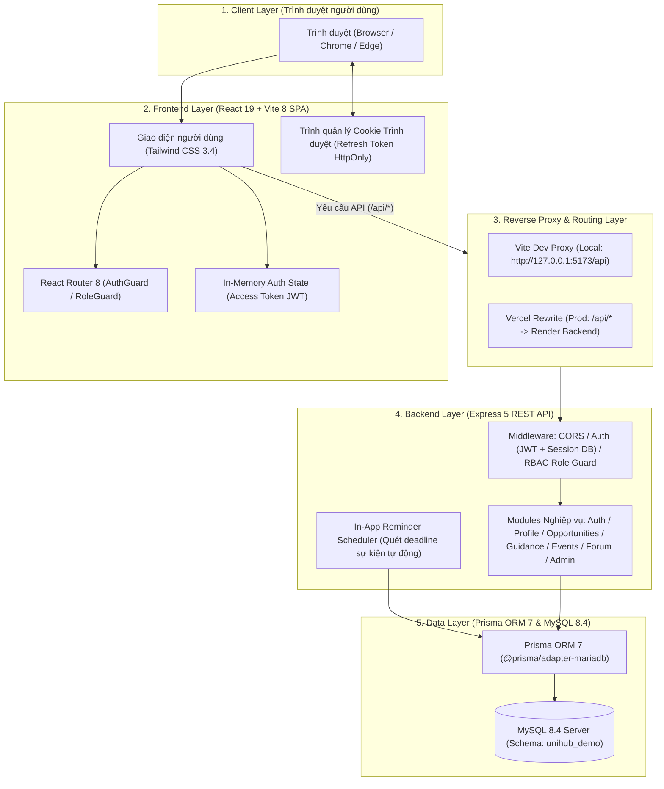
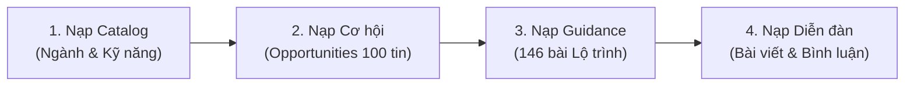

# UniHub – Nền tảng Hỗ trợ Học tập và Định hướng Nghề nghiệp cho Sinh viên

UniHub là nền tảng web tập trung giúp sinh viên tiếp cận các cơ hội học tập, thực tập, việc làm và học bổng tin cậy; tra cứu lộ trình phát triển kỹ năng chuẩn hóa; nhận gợi ý cơ hội cá nhân hóa theo hồ sơ học thuật; quản lý lịch học tập/deadline và tham gia diễn đàn trao đổi sinh viên. Hệ thống tích hợp cổng quản trị hoàn chỉnh dành cho Quản trị viên (Admin) để thẩm định tin tuyển dụng, kiểm duyệt nội dung cộng đồng, quản lý danh mục và phân quyền người dùng.

> **Tài liệu này là hướng dẫn chính thức phục vụ bàn giao mã nguồn đồ án và cài đặt cục bộ (Local Environment) trên hệ điều hành Windows (PowerShell) với Node.js và MySQL Server, không phụ thuộc Docker hay dịch vụ hosting thương mại.**

---

## 1. Giới thiệu UniHub

### 1.1. Tên đề tài

**Xây dựng UniHub – Nền tảng hỗ trợ học tập và định hướng nghề nghiệp cho sinh viên.**

### 1.2. Mục tiêu và bài toán giải quyết

Dự án UniHub giải quyết 3 rào cản thông tin lớn nhất của sinh viên đại học hiện nay:

1. **Thông tin phân mảnh:** Cơ hội thực tập, việc làm và học bổng nằm rải rác trên mạng xã hội, diễn đàn, website tuyển dụng và các kênh thông báo riêng lẻ của trường/khoa, khiến sinh viên mất nhiều thời gian tìm kiếm.
2. **Độ tin cậy chưa được kiểm chứng:** Thiếu cơ chế kiểm định chất lượng, dẫn đến nguy cơ gặp phải tin tuyển dụng lừa đảo, đa cấp trá hình hoặc thông tin đã hết hạn nộp hồ sơ.
3. **Thiếu tính cá nhân hóa:** Thông tin tuyển dụng đại trà không được chọn lọc phù hợp với chuyên ngành, năm học và bộ kỹ năng hiện tại của từng sinh viên.

**Giải pháp của UniHub:**

- Tập trung hóa dữ liệu cơ hội và cung cấp bộ lọc đa chiều (ngành học, loại cơ hội, hình thức làm việc).
- Quy trình thẩm định nội dung 2 lớp với nhãn chứng thực **Verified** do Quản trị viên trực tiếp xác minh.
- Chuẩn hóa lộ trình kỹ năng (Guidance Roadmaps) theo từng giai đoạn học tập.
- Thuật toán gợi ý cá nhân hóa trọng số (Heuristic Matching) kết hợp giữa Ngành (40%), Năm học (30%) và Kỹ năng (30%).
- Bộ công cụ gia tăng năng suất học tập: Lịch sự kiện cá nhân, trình quét nhắc nhở deadline tự động (In-app Reminder Scheduler) và Diễn đàn sinh viên.

### 1.3. Đối tượng người dùng

Hệ thống phân quyền Role-Based Access Control (RBAC) chặt chẽ với 3 nhóm người dùng:

- **Khách vãng lai (Guest):** Người dùng chưa đăng nhập, được tự do xem trang chủ, tra cứu danh sách cơ hội đã phê duyệt, đọc lộ trình kỹ năng và xem nội dung diễn đàn công khai.
- **Sinh viên (Student):** Người dùng xác thực qua tài khoản Google, quản lý hồ sơ học tập (chuyên ngành, năm học, mục tiêu nghề nghiệp, kỹ năng), nhận gợi ý cơ hội cá nhân hóa, quản lý lịch/deadline cá nhân và tham gia thảo luận trên diễn đàn.
- **Quản trị viên (Admin):** Người quản trị hệ thống, sử dụng Admin Dashboard theo dõi số liệu thời gian thực, thẩm định duyệt/từ chối/gán nhãn Verified cho tin tuyển dụng, kiểm duyệt gỡ bài viết/bình luận vi phạm, quản lý danh mục ngành/kỹ năng và phân quyền tài khoản.

### 1.4. Các nhóm chức năng chính

- **FR-01 (Tài khoản & Hồ sơ):** Xác thực Google OAuth 2.0, bảo mật phiên 2 lớp (JWT Bearer + HttpOnly Refresh Cookie), quản lý hồ sơ học tập chuyên ngành và kỹ năng.
- **FR-02 (Hub Cơ hội & Tìm kiếm):** Tra cứu cơ hội việc làm/thực tập/học bổng đã phê duyệt, tìm kiếm theo từ khóa và kết hợp bộ lọc (Ngành, Loại cơ hội, Hình thức làm việc).
- **FR-03 (Lộ trình kỹ năng & Gợi ý cơ hội):** Đọc tài liệu định hướng nghề nghiệp theo ngành; thuật toán Heuristic Matching tính điểm độ tương thích và xếp hạng gợi ý theo hồ sơ.
- **FR-04 (Lịch học tập & Nhắc nhở):** Quản lý sự kiện và deadline cá nhân (CRUD), tiến trình nền Backend Scheduler tự động quét mốc thời gian và gửi chuông thông báo nhắc nhở trong ứng dụng.
- **FR-05 (Diễn đàn sinh viên):** Thảo luận học tập, chia sẻ kinh nghiệm phỏng vấn, tạo bài viết mới, gửi bình luận và phân cấp chủ đề.
- **SYS-01 & SYS-02 (Quản trị hệ thống):** Thống kê số liệu Dashboard, thẩm định cơ hội, kiểm duyệt diễn đàn, quản lý đóng/mở danh mục, quản lý vai trò tài khoản và ghi nhận Activity Logs phục vụ kiểm toán an toàn.

---

## 2. Website Demo

Hệ thống đã được đóng gói và triển khai trực tuyến trên hạ tầng đám mây:

- **Website Demo (Frontend):** [https://uni-hub-5myf.vercel.app/](https://uni-hub-5myf.vercel.app/)
- **Backend REST API:** [https://unihub-i02l.onrender.com](https://unihub-i02l.onrender.com)
- **Health Check Endpoint:** [https://unihub-i02l.onrender.com/api/health](https://unihub-i02l.onrender.com/api/health)
- **Readiness Check Endpoint:** [https://unihub-i02l.onrender.com/api/ready](https://unihub-i02l.onrender.com/api/ready)

> [!NOTE]
> **Phân biệt môi trường Demo Cloud và Môi trường Bàn giao Local:**
>
> - Website demo trực tuyến sử dụng cụm dịch vụ đám mây (Vercel + Render + CSDL Aiven MySQL 8.4) với bộ dữ liệu demo đầy đủ phục vụ thẩm định trực quan.
> - Bản bàn giao mã nguồn này hướng dẫn thiết lập **môi trường cục bộ hoàn toàn độc lập** trên máy tính của người chấm thi với cơ sở dữ liệu `unihub_demo`.
> - **Nguyên tắc bảo mật:** Tài liệu này không công khai thông tin tài khoản Admin, mật khẩu, JWT secrets, session token hoặc chuỗi kết nối CSDL production.

---

## 3. Công nghệ sử dụng

Bảng công nghệ được đối chiếu chính xác theo khai báo trong `package.json` và cấu hình triển khai thực tế của dự án:

| Thành phần               | Công nghệ / Thư viện      | Phiên bản       | Mục đích & Vai trò trong hệ thống                                                   |
| :----------------------- | :------------------------ | :-------------- | :---------------------------------------------------------------------------------- |
| **Frontend Framework**   | React / React DOM         | `19.3.1`        | Xây dựng giao diện người dùng Single Page Application (SPA) hiệu năng cao           |
| **Routing**              | React Router              | `8.5.0`         | Quản lý điều hướng client-side, phân tách phân quyền Guest / Student / Admin        |
| **Build Tool / Bundler** | Vite                      | `8.3.5`         | Bundler tối ưu hóa tốc độ biên dịch, Hot Module Replacement và Dev Proxy            |
| **CSS Styling**          | Tailwind CSS              | `3.4.19`        | Framework CSS utility-first (đi kèm PostCSS 8.5, Autoprefixer 10.6)                 |
| **Ngôn ngữ Frontend**    | TypeScript                | `5.9.3`         | Kiểm soát an toàn kiểu dữ liệu compile-time toàn diện cho giao diện                 |
| **Backend Runtime**      | Node.js (LTS)             | `>=24.19.0 <25` | Môi trường thực thi JavaScript/TypeScript server-side chuẩn Node 24                 |
| **Web Framework**        | Express                   | `5.3.0`         | Khung xử lý REST API, điều phối middleware, routing và xử lý ngoại lệ               |
| **Database ORM**         | Prisma ORM                | `7.10.1`        | Quản trị schema CSDL, sinh migration tự động, type-safe query builder               |
| **Database Driver**      | `@prisma/adapter-mariadb` | `7.10.1`        | Trình điều khiển kết nối MariaDB/MySQL hiệu năng cao cho Prisma 7                   |
| **Authentication**       | `google-auth-library`     | `11.3.1`        | Xác thực tính hợp lệ của Google ID Token phía máy chủ Backend                       |
| **Token / Bảo mật**      | `jose`                    | `6.2.13`        | Ký, mã hóa và xác thực JSON Web Token (Access Token JWT) an toàn                    |
| **Trình thực thi TS**    | `tsx`                     | `4.23.15`       | Chạy TypeScript ES modules trực tiếp phía backend trong môi trường phát triển       |
| **Hệ quản trị CSDL**     | MySQL Server              | `8.4.x LTS`     | CSDL quan hệ lưu trữ 13 bảng nghiệp vụ, hỗ trợ transaction và row-level lock        |
| **Kiểm thử tự động**     | Node.js Test Runner       | Native          | Khung chạy unit test và integration test (`node --test`), không phụ thuộc 3rd party |
| **Định dạng mã nguồn**   | Prettier                  | `3.6.2`         | Đảm bảo chuẩn format code nhất quán trên toàn bộ npm workspaces                     |
| **Hạ tầng Đám mây**      | Vercel & Render           | Cloud           | Vercel lưu trữ Frontend SPA; Render lưu trữ Web Service Backend                     |

---

## 4. Kiến trúc hệ thống

UniHub được xây dựng theo mô hình kiến trúc phân tầng (Multi-tier Architecture) với nguyên tắc phân tách trách nhiệm (Separation of Concerns):



### Nguyên lý vận hành các tầng:

1. **Frontend Layer (React 19 SPA):** Đảm nhiệm việc kết xuất giao diện, bắt các sự kiện người dùng và bảo vệ route client-side thông qua `<RequireRole>`. Access Token được lưu trữ trong bộ nhớ RAM (`auth-state.ts`), không lưu trữ ở `localStorage` nhằm phòng ngừa nguy cơ tấn công XSS đánh cắp token.
2. **Reverse Proxy & Routing:** Giúp đồng nhất origin giữa client và server. Môi trường local sử dụng proxy tích hợp của Vite; môi trường Cloud sử dụng cơ chế rewrite của Vercel nhằm đảm bảo cookie Refresh Token được trao đổi an toàn dưới dạng cùng nguồn gốc (same-origin).
3. **Backend Layer (Express 5):** Thực thi toàn bộ quy tắc nghiệp vụ. Mọi request cần xác thực đều trải qua Middleware kiểm tra tính hợp lệ của chữ ký số JWT và đối chiếu phiên thực tế trong bảng `auth_sessions` (ngăn chặn tình trạng token cũ bị lạm dụng sau khi bị hạ quyền Admin).
4. **Data Layer (Prisma ORM & MySQL 8.4):** Áp dụng mô hình CSDL chuẩn hóa 13 bảng quan hệ. Các tác vụ nhạy cảm (như hạ quyền Admin, cập nhật vai trò, xử lý kiểm duyệt) được bọc trong Prisma Transaction với cơ chế khóa dòng (`SELECT ... FOR UPDATE`) để hạn chế rủi ro tương tranh (Race Condition) và bảo vệ an toàn cho Admin cuối cùng.

---

## 5. Cấu trúc thư mục

Cấu trúc mã nguồn thực tế trong repository được tổ chức chuẩn mực theo mô hình npm workspaces:

```text
UniHub/
├── frontend/                     # Ứng dụng giao diện React 19 + Vite 8
│   ├── src/
│   │   ├── app/                  # Router chính (router.tsx), Root App, Health dev
│   │   ├── components/           # Các thành phần UI nguyên tử (Button, Modal, Input, Badge)
│   │   ├── features/             # Các module tính năng độc lập theo chức năng:
│   │   │   ├── auth/             # Google Sign-In, AuthProvider, AuthGuard, LoginLayout
│   │   │   ├── opportunities/    # Hub cơ hội việc làm, bộ lọc đa tiêu chí, chi tiết tin
│   │   │   ├── recommendations/  # Trang gợi ý cơ hội cá nhân hóa
│   │   │   ├── guidance/         # Lộ trình kỹ năng chuyên ngành và bài viết định hướng
│   │   │   ├── calendar/         # Lịch học tập, CRUD sự kiện, quản lý deadline
│   │   │   ├── notifications/    # Chuông thông báo nhắc nhở in-app
│   │   │   ├── forum/            # Diễn đàn sinh viên, bài thảo luận, bình luận
│   │   │   └── admin/            # Phân hệ quản trị (Dashboard, Moderation, Categories, Users)
│   │   ├── layouts/              # Khung giao diện (PublicLayout, StudentLayout, AdminLayout)
│   │   └── lib/                  # Tiện ích gọi API client (apiRequest, protectedApiRequest)
│   ├── package.json              # Khai báo dependency và scripts cho frontend
│   └── vite.config.ts            # Cấu hình Vite bundler và API Dev Proxy
├── backend/                      # Dịch vụ Express 5 REST API
│   ├── src/
│   │   ├── modules/              # Các module điều phối nghiệp vụ backend:
│   │   │   ├── auth/             # Xác thực Google OAuth, cấp JWT & Refresh Session
│   │   │   ├── users/            # Hồ sơ sinh viên & Quản lý tài khoản Admin (RBAC)
│   │   │   ├── opportunities/    # Tra cứu, tìm kiếm và lọc cơ hội
│   │   │   ├── recommendations/  # Thuật toán Heuristic Matching tính điểm cơ hội
│   │   │   ├── guidance/         # Lộ trình kỹ năng và bài viết hướng nghiệp
│   │   │   ├── events/           # Lịch cá nhân & Scheduler quét deadline tự động
│   │   │   ├── notifications/    # API thông báo và đánh dấu đã đọc
│   │   │   ├── forum/            # Quản lý bài thảo luận, bình luận diễn đàn
│   │   │   ├── categories/       # Quản lý danh mục ngành học & kỹ năng
│   │   │   ├── admin-opportunities/ # Thẩm định, duyệt tin, gán Verified Badge
│   │   │   ├── dashboard/        # Tính toán số liệu thống kê Admin Dashboard
│   │   │   └── activity-logs/    # Ghi nhận nhật ký kiểm toán quản trị
│   │   ├── middleware/           # Tầng middleware: auth, error handler, role guard
│   │   ├── scripts/              # Scripts tiện ích: admin-bootstrap.ts, opportunities-import.ts
│   │   ├── server.ts             # Khởi tạo HTTP server & Background Scheduler
│   │   └── app.ts                # Cấu hình Express app và gắn kết các route
│   ├── prisma/                   # Quản lý cơ sở dữ liệu
│   │   ├── schema.prisma         # Mô hình 13 bảng quan hệ UniHub
│   │   ├── prisma.config.ts      # Cấu hình MariaDB adapter cho Prisma 7
│   │   └── migrations/           # Lịch sử các file SQL migration
│   └── package.json              # Khai báo dependency và scripts cho backend
├── data/                         # Dữ liệu kiểm thử và demo có kiểm soát
│   ├── catalog/                  # Dữ liệu danh mục ngành học & kỹ năng chuẩn
│   ├── opportunities/            # Bộ dữ liệu 100 cơ hội việc làm/thực tập mẫu
│   ├── guidance/                 # 146 bài viết lộ trình kỹ năng định hướng
│   └── forum/                    # Dữ liệu tác giả, bài viết và bình luận diễn đàn mẫu
├── docs/                         # Hệ thống tài liệu kiến trúc, kỹ thuật và kiểm thử
│   ├── architecture.md           # Tài liệu thiết kế kiến trúc chi tiết
│   ├── technology-stack.md       # Chi tiết công nghệ sử dụng
│   ├── api-contracts.md          # Đặc tả giao tiếp các endpoint REST API
│   ├── database-schema.md        # Thiết kế 13 bảng CSDL và quan hệ ràng buộc
│   ├── LOCAL-SETUP-UNIHUB-DEMO.md # Hướng dẫn cài đặt CSDL MySQL cục bộ
│   ├── demo-seed-workflow.md     # Quy trình nạp dữ liệu demo chuẩn
│   ├── fresh-install-acceptance.md # Checklist nghiệm thu máy sạch
│   └── testing/                  # Báo cáo kết quả kiểm thử và ảnh minh chứng 28 test case nghiệm thu
├── package.json                  # Cấu hình npm workspaces gốc và scripts vận hành toàn dự án
└── package-lock.json             # Khóa phiên bản dependency đồng bộ toàn bộ dự án
```

---

## 6. Yêu cầu hệ thống

Trước khi tiến hành cài đặt, máy tính cần đáp ứng các tiêu chuẩn sau:

### 6.1. Điều kiện bắt buộc (Mandatory)

- **Hệ điều hành:** Windows 10 hoặc Windows 11 (khuyến nghị sử dụng PowerShell).
- **Node.js:** Phiên bản `>=24.19.0 <25` (Node.js 24 LTS).
- **npm:** Phiên bản `>=11.9.0 <12` (sử dụng lệnh `npm.cmd` trong PowerShell để tránh chính sách Execution Policy của `npm.ps1`).
- **MySQL Server:** Phiên bản **MySQL 8.4.x LTS** đang chạy dưới dạng dịch vụ hệ thống (Service), có quyền quản trị DBA để tạo database và phân quyền người dùng.
- **Git:** Đã cài đặt Git để quản lý mã nguồn.
- **Trình duyệt web:** Google Chrome, Microsoft Edge hoặc Mozilla Firefox phiên bản mới.
- **Google Cloud OAuth Client ID:** Cần một **OAuth 2.0 Web Client ID** hợp lệ được tạo từ Google Cloud Console có khai báo Authorized JavaScript origin là `http://127.0.0.1:5173`.

### 6.2. Điều kiện khuyến nghị (Recommended)

- Công cụ trực quan hóa CSDL: **MySQL Workbench** hoặc **DBeaver** để kiểm tra dữ liệu và xem bảng `activity_logs`.
- Kết nối Internet ổn định trong quá trình chạy ứng dụng để backend xác thực Google ID Token với máy chủ của Google.

---

## 7. Hướng dẫn cài đặt và chạy local

Quy trình 10 bước chuẩn dành cho người mới tiếp nhận mã nguồn UniHub:

### Bước 1 — Lấy mã nguồn và kiểm tra môi trường

Mở PowerShell tại thư mục làm việc của bạn:

```powershell
git clone --branch main https://github.com/KhanhHuyen444/UniHub.git
Set-Location .\UniHub
node --version
npm.cmd --version
```

_(Đảm bảo Node.js hiển thị đầu ra `v24.x.x` và npm hiển thị `11.x.x`)_.

### Bước 2 — Cài đặt dependencies

Chạy lệnh cài đặt đồng bộ toàn bộ workspace từ file khóa `package-lock.json`:

```powershell
npm.cmd ci
```

### Bước 3 — Chuẩn bị CSDL MySQL `unihub_demo` và 2 tài khoản

Đăng nhập vào MySQL CLI hoặc MySQL Workbench bằng tài khoản quản trị viên tối cao (root/DBA):

```sql
-- 1. Tạo database unihub_demo với bộ mã ký tự chuẩn UTF-8
CREATE DATABASE `unihub_demo`
  CHARACTER SET utf8mb4
  COLLATE utf8mb4_0900_as_ci;

-- 2. Tạo tài khoản migrator (chuyên trách chạy DDL migration)
CREATE USER 'unihub_demo_migrator'@'127.0.0.1' IDENTIFIED BY 'MatKhauMigrator123!@#';
GRANT ALL PRIVILEGES ON `unihub_demo`.* TO 'unihub_demo_migrator'@'127.0.0.1';

-- 3. Tạo tài khoản app runtime (chuyên trách ứng dụng chạy hàng ngày, chỉ DML)
CREATE USER 'unihub_demo_app'@'127.0.0.1' IDENTIFIED BY 'MatKhauAppRuntime123!@#';

FLUSH PRIVILEGES;
```

_(Ghi chú: Thay đổi mật khẩu phù hợp trên máy tính của bạn và không chia sẻ mật khẩu vào Git)._

### Bước 4 — Tạo các file cấu hình môi trường (.env)

Tại thư mục gốc `UniHub`, tạo các file `.env` từ file mẫu:

```powershell
if (-not (Test-Path .\backend\.env)) { Copy-Item .\backend\.env.example .\backend\.env }
if (-not (Test-Path .\backend\.env.migration)) { Copy-Item .\backend\.env.migration.example .\backend\.env.migration }
if (-not (Test-Path .\frontend\.env)) { Copy-Item .\frontend\.env.example .\frontend\.env }
```

### Bước 5 — Cấu hình biến môi trường

Mở các file vừa tạo và điền thông số kết nối cục bộ:

- **`backend/.env` (Tài khoản Runtime):**
  ```env
  PORT=3001
  DATABASE_URL=mysql://unihub_demo_app:MatKhauAppRuntime123!@#@127.0.0.1:3306/unihub_demo
  JWT_SIGNING_SECRET=unihub_super_secret_jwt_key_at_least_32_bytes_long_2026
  JWT_ISSUER=unihub-backend
  JWT_AUDIENCE=unihub-app
  GOOGLE_CLIENT_ID=<Điền_Google_OAuth_Web_Client_ID_của_bạn>
  AUTH_ALLOWED_ORIGINS=http://127.0.0.1:5173
  ```
- **`backend/.env.migration` (Tài khoản Migrator):**
  ```env
  MIGRATION_DATABASE_URL=mysql://unihub_demo_migrator:MatKhauMigrator123!@#@127.0.0.1:3306/unihub_demo
  ```
- **`frontend/.env`:**
  ```env
  API_PROXY_TARGET=http://127.0.0.1:3001
  VITE_GOOGLE_CLIENT_ID=<Điền_cùng_Google_OAuth_Web_Client_ID_như_backend>
  ```

### Bước 6 — Xác thực schema và thực thi Prisma Migrations

Chạy chuỗi lệnh kiểm tra schema, triển khai cấu trúc bảng và sinh Prisma Client:

```powershell
npm.cmd run prisma:validate
npm.cmd run db:migrate:status
npm.cmd run db:migrate:deploy
npm.cmd run prisma:generate
```

> [!IMPORTANT]
> Lệnh `db:migrate:deploy` sẽ tạo đầy đủ 13 bảng nghiệp vụ và bảng `_prisma_migrations`. **Khuyến nghị không sử dụng `prisma migrate reset` hoặc lệnh `DROP DATABASE`** để tránh làm gián đoạn hoặc mất mát dữ liệu đang kiểm thử.

### Bước 7 — Cấp quyền thao tác bảng chi tiết cho `unihub_demo_app`

Sau khi các bảng đã được tạo thành công, mở lại MySQL CLI/Workbench bằng quyền DBA và thực thi cấp quyền thao tác dữ liệu (DML) cho user runtime theo nguyên tắc đặc quyền tối thiểu (Least Privilege):

```sql
GRANT SELECT, INSERT, UPDATE, DELETE ON `unihub_demo`.* TO 'unihub_demo_app'@'127.0.0.1';
-- Riêng bảng activity_logs chỉ cho phép đọc và ghi thêm, cấm sửa và cấm xóa
REVOKE UPDATE, DELETE ON `unihub_demo`.`activity_logs` FROM 'unihub_demo_app'@'127.0.0.1';
FLUSH PRIVILEGES;
```

### Bước 8 — Biên dịch dự án (Build)

Biên dịch TypeScript cho cả frontend và backend để đảm bảo không có lỗi cú pháp hoặc xung đột kiểu dữ liệu:

```powershell
npm.cmd run build
```

### Bước 9 — Khởi động Backend và Frontend

Mở **2 cửa sổ PowerShell riêng biệt** tại thư mục gốc `UniHub`:

- **Cửa sổ 1 — Khởi động Backend:**

  ```powershell
  npm.cmd run dev:backend
  ```

  _(Backend sẽ lắng nghe tại: `http://127.0.0.1:3001` và kích hoạt In-App Reminder Scheduler)_.

- **Cửa sổ 2 — Khởi động Frontend:**
  ```powershell
  npm.cmd run dev:frontend
  ```
  _(Frontend Vite sẽ mở tại: `http://127.0.0.1:5173/`)_.

### Bước 10 — Kiểm tra tính sẵn sàng (Health & Readiness Check)

Mở cửa sổ PowerShell thứ 3 và kiểm tra kết nối API:

```powershell
Invoke-RestMethod http://127.0.0.1:3001/api/health
Invoke-RestMethod http://127.0.0.1:3001/api/ready
```

- Endpoint `/api/health` trả về `{"status":"ok"}`: Xác nhận HTTP server Express hoạt động.
- Endpoint `/api/ready` trả về `{"status":"available"}`: Xác nhận Backend đã kết nối thành công và truy vấn được CSDL MySQL `unihub_demo`.

---

## 8. Google Login và Admin Bootstrap

### 8.1. Cấu hình Google Cloud Console

1. Truy cập [Google Cloud Console](https://console.cloud.google.com/) -> **APIs & Services** -> **Credentials**.
2. Tạo mới **OAuth 2.0 Client ID** loại **Web application**.
3. Tại mục **Authorized JavaScript origins**, thêm chính xác URL cục bộ:
   - `http://127.0.0.1:5173`
     _(Lưu ý: Không dùng `localhost` để tránh lỗi xung đột cookie trình duyệt; thống nhất dùng `127.0.0.1`)_.
4. Sao chép Client ID và dán vào cả hai file `backend/.env` (`GOOGLE_CLIENT_ID`) và `frontend/.env` (`VITE_GOOGLE_CLIENT_ID`).

### 8.2. Đăng nhập lần đầu tạo tài khoản Student

1. Truy cập trình duyệt vào `http://127.0.0.1:5173/login`.
2. Bấm nút **Đăng nhập với Google** và chọn tài khoản Google của bạn.
3. Khi đăng nhập thành công, Backend sẽ tự động tạo một bản ghi tài khoản mới trong bảng `users` với vai trò mặc định là **`Student`**.
4. Sinh viên có thể cập nhật thông tin hồ sơ học thuật (Chuyên ngành, Năm học, Mục tiêu, Kỹ năng) tại trang `/profile`.

### 8.3. Khởi tạo tài khoản Quản trị viên đầu tiên (Admin Bootstrap)

Hệ thống UniHub tích hợp script bootstrap độc lập và an toàn nhằm chỉ cấp quyền cho tài khoản Admin đầu tiên của hệ thống:

1. Mở CSDL bằng Workbench/CLI, tra cứu giá trị `google_sub` của tài khoản vừa đăng nhập:
   ```sql
   SELECT user_id, email, full_name, google_sub, role FROM unihub_demo.users;
   ```
2. Tại PowerShell gốc của dự án, chạy lệnh bootstrap có xác nhận tương tác:
   ```powershell
   npm.cmd run admin:bootstrap
   ```
3. Nhập giá trị `google_sub` khi được hỏi. Hệ thống sẽ kiểm tra:
   - Xác minh người dùng có tồn tại trong CSDL hay không.
   - Xác minh hệ thống hiện tại **chưa có bất kỳ Quản trị viên (Admin) nào**.
   - Nếu đủ điều kiện, hệ thống sẽ nâng quyền tài khoản lên **`Admin`** và ghi nhận sự kiện vào `activity_logs`.
4. Trên trình duyệt, bấm **Đăng xuất** và thực hiện **Đăng nhập lại với Google** để hệ thống cấp Access Token và Refresh Token mang vai trò Admin mới.
5. Kiểm tra truy cập vào thanh điều hướng Admin hoặc truy cập trực tiếp `http://127.0.0.1:5173/admin/dashboard`.

> [!WARNING]
> Script bootstrap chỉ hoạt động duy nhất khi hệ thống chưa có Quản trị viên nào. Khi đã có ít nhất một Admin, script sẽ từ chối thực thi nhằm bảo vệ an toàn phân quyền. Các tài khoản Admin tiếp theo sẽ do chính Quản trị viên hiện tại nâng quyền trong trang giao diện `/admin/users` (theo Use Case UC-14).

---

## 9. Dữ liệu mẫu (Demo Seed Workflow)

> [!IMPORTANT]
> Quá trình chạy Prisma migration chỉ khởi tạo cấu trúc 13 bảng trắng rỗng, **không tự động nạp dữ liệu mẫu**. Để có dữ liệu đầy đủ phục vụ chấm thi và demo, người vận hành cần thực hiện nạp dữ liệu theo đúng thứ tự 4 bước dưới đây.
> Mọi script nạp dữ liệu đều hỗ trợ chế độ kiểm tra trước **`--dry-run`** (không ghi vào CSDL) và chỉ thực sự ghi khi có tham số **`--apply`**.

Thứ tự nạp dữ liệu chuẩn tắc (Xem chi tiết tại [docs/demo-seed-workflow.md](docs/demo-seed-workflow.md)):



### Bước 1 — Nạp Danh mục ngành và kỹ năng (Catalog)

Chạy lần lượt nạp bộ cơ bản, bộ ngành mở rộng, kỹ năng mở rộng và snapshot tổng hợp:

```powershell
# 1. Bộ danh mục cơ bản
node --env-file=backend/.env backend/dist/scripts/opportunities-import.js --catalog-only --file data/catalog/initial-categories.json --apply

# 2. Bộ ngành mở rộng
node --env-file=backend/.env backend/dist/scripts/opportunities-import.js --catalog-only --file data/catalog/expanded-majors.json --apply

# 3. Bộ kỹ năng mở rộng
node --env-file=backend/.env backend/dist/scripts/opportunities-import.js --catalog-only --file data/catalog/expanded-skills.json --apply

# 4. Snapshot danh mục đầy đủ (bổ sung ngành Kinh doanh số & AI)
node --env-file=backend/.env backend/dist/scripts/opportunities-import.js --catalog-only --file data/opportunities/demo/catalog.json --apply
```

_(Kết quả kỳ vọng: Tạo đủ **117 Chuyên ngành** và **328 Kỹ năng** ở trạng thái `Active`)_.

### Bước 2 — Nạp 100 cơ hội việc làm & thực tập mẫu

```powershell
node --env-file=backend/.env backend/dist/scripts/opportunities-import.js --file data/opportunities/demo/batch-proposal.json --apply
```

_(Kết quả kỳ vọng: Nạp thành công 100 cơ hội ở trạng thái ban đầu là **`Pending`**. Quản trị viên sẽ truy cập `/admin/moderation` trên giao diện web để duyệt các tin này sang trạng thái **`Approved`** hoặc gán nhãn **`Verified`** để tin hiển thị công khai trên Hub cơ hội)_.

### Bước 3 — Nạp bài viết Lộ trình kỹ năng định hướng (Guidance)

```powershell
node --env-file=backend/.env data/guidance/demo/seed-guidance-demo.mjs --apply
node --env-file=backend/.env data/guidance/demo/seed-guidance-demo.mjs --verify
```

_(Kết quả kỳ vọng: Nạp **146 bài viết định hướng** cho 100 ngành học và 17 ngành chủ động để trạng thái chờ bổ sung)_.

### Bước 4 — Nạp bài thảo luận và bình luận Diễn đàn (Forum)

```powershell
node --env-file=backend/.env data/forum/demo/seed-forum-demo.mjs --apply
```

_(Kết quả kỳ vọng: Nạp **12 tác giả mẫu**, **24 bài thảo luận** đa chủ đề và **136 bình luận**)_.

---

## 10. Chạy kiểm thử (Quality Assurance)

Dự án thiết lập quy trình kiểm thử đa tầng nghiêm ngặt nhằm đảm bảo độ tin cậy của mã nguồn trước khi bàn giao:

```powershell
# 1. Kiểm tra tính hợp lệ của schema Prisma
npm.cmd run prisma:validate

# 2. Kiểm tra an toàn kiểu dữ liệu TypeScript trên cả 2 workspace
npm.cmd run typecheck

# 3. Biên dịch bản sản xuất hoàn chỉnh
npm.cmd run build

# 4. Thực thi toàn bộ bộ kiểm thử tự động (Unit & Integration Tests)
npm.cmd test

# 5. Kiểm tra định dạng mã nguồn chuẩn Prettier
npm.cmd run format:check

# 6. Kiểm tra các dòng trống hoặc khoảng trắng thừa trong Git
git diff --check
```

### Phân biệt 2 cấp độ kiểm thử trong dự án:

1. **Automated Test Suite trong mã nguồn (`npm test`):**
   - Chạy thông qua trình test runner chuẩn của Node.js (`node --test`).
   - Bao gồm 273 tests phía Frontend (**214 PASS / 0 FAIL / 59 SKIP**) và 282 tests phía Backend (**259 PASS / 0 FAIL / 23 SKIP**).
   - Các bài test SKIP là các bài kiểm thử phụ thuộc vào trình duyệt Chromium thực tế hoặc CSDL MySQL ngoài môi trường sandbox cục bộ.
2. **Bộ 28 Test Case Nghiệm thu Chức năng Đồ án (Functional Acceptance Testing):**
   - Bộ 28 kịch bản kiểm thử nghiệm thu chức năng chính thức (5 Guest, 12 Student, 10 Admin, 1 Ngoại lệ & Bảo mật) đối chiếu từ bảng tổng hợp kết quả nghiệm thu của nhóm trên Google Sheets.
   - Ghi nhận đầy đủ **28/28 PASS** đối chiếu theo bộ kịch bản kiểm thử nghiệm thu chính thức của đề tài (ảnh chụp minh chứng và bảng chi tiết được quản lý riêng theo hồ sơ nghiệm thu đồ án).
   - Các kịch bản kiểm thử nâng cao về bảo vệ Admin cuối cùng (Last Admin Protection), chống tấn công tương tranh (Race Condition) và thu hồi quyền tức thì được phân loại thuộc bộ regression/integration automated tests bổ sung trong source code.

---

## 11. Chức năng theo vai trò

Danh mục route và phân quyền chi tiết được đối chiếu trực tiếp từ file router chính [`frontend/src/app/router.tsx`](frontend/src/app/router.tsx):

| Vai trò      | Phân hệ chức năng   | Đường dẫn (Route)           | Mô tả chi tiết chức năng                                                           |
| :----------- | :------------------ | :-------------------------- | :--------------------------------------------------------------------------------- |
| **Guest**    | Trang chủ           | `/`                         | Giới thiệu nền tảng, số liệu tổng quan, bài viết nổi bật và điều hướng nhanh       |
| **Guest**    | Hub Cơ hội          | `/opportunities`            | Tra cứu danh sách cơ hội việc làm, thực tập, học bổng đã duyệt; lọc đa chiều       |
| **Guest**    | Chi tiết Cơ hội     | `/opportunities/:id`        | Xem chi tiết yêu cầu, kỹ năng bắt buộc, đãi ngộ và link ứng tuyển gốc              |
| **Guest**    | Lộ trình Kỹ năng    | `/roadmaps`                 | Tra cứu lộ trình phát triển nghề nghiệp chuẩn hóa theo từng chuyên ngành           |
| **Guest**    | Chi tiết Lộ trình   | `/roadmaps/:id`             | Xem nội dung hướng nghiệp chi tiết, kỹ năng cốt lõi và các giai đoạn học           |
| **Guest**    | Diễn đàn Sinh viên  | `/forum`                    | Xem danh sách các bài viết thảo luận cộng đồng theo chuyên mục                     |
| **Guest**    | Chi tiết Thảo luận  | `/forum/:id`                | Đọc nội dung bài thảo luận và toàn bộ cây bình luận của sinh viên                  |
| **Guest**    | Đăng nhập           | `/login`                    | Nút đăng nhập Google Identity Services tích hợp bảo mật                            |
| **Student**  | Hồ sơ Học thuật     | `/profile`                  | Cập nhật Chuyên ngành, Năm học, Mục tiêu nghề nghiệp và Kỹ năng cá nhân            |
| **Student**  | Gợi ý Cá nhân hóa   | `/recommendations`          | Danh sách cơ hội được hệ thống tính điểm phù hợp Heuristic (Score ≥ 0.50)          |
| **Student**  | Lịch & Deadline     | `/calendar`                 | Lịch cá nhân, thêm/sửa/xóa sự kiện, đánh dấu hoàn thành, hẹn giờ nhắc nhở          |
| **Student**  | Thông báo In-App    | Popover Chuông góc phải     | Nhận thông báo tự động từ Scheduler khi sắp đến hạn deadline sự kiện               |
| **Student**  | Tương tác Diễn đàn  | `/forum` & `/forum/:id`     | Đăng câu hỏi mới, gửi bình luận trả lời, chia sẻ kinh nghiệm phỏng vấn             |
| **Admin**    | Tổng quan Hệ thống  | `/admin/dashboard`          | Bảng điều khiển giám sát số liệu tin tuyển dụng, bài viết, người dùng              |
| **Admin**    | Thẩm định Cơ hội    | `/admin/moderation` (Tab 1) | Duyệt tin (Approved), từ chối kèm lý do (Rejected), gán nhãn chứng thực (Verified) |
| **Admin**    | Kiểm duyệt Diễn đàn | `/admin/moderation` (Tab 2) | Gỡ bỏ bài viết/bình luận vi phạm chuẩn mực cộng đồng, khôi phục nội dung           |
| **Admin**    | Quản lý Danh mục    | `/admin/categories`         | Thêm mới ngành học/kỹ năng, chỉnh sửa tên, đóng/mở trạng thái (Active/Closed)      |
| **Admin**    | Quản lý Tài khoản   | `/admin/users`              | Danh sách tài khoản người dùng, tìm kiếm, nâng quyền Admin, hạ quyền Student       |
| **Hệ thống** | Kiểm tra Kỹ thuật   | `/_dev/health`              | Màn hình kiểm tra trạng thái frontend, backend và dev proxy                        |

---

## 12. Tài liệu tham khảo và bàn giao

Hệ thống tài liệu kỹ thuật chi tiết của dự án UniHub được lưu trữ đầy đủ trong thư mục `docs/`:

1. **Kiến trúc & Phân tích thiết kế:**
   - [docs/architecture.md](docs/architecture.md) – Tài liệu thiết kế kiến trúc hệ thống tổng thể.
   - [docs/technology-stack.md](docs/technology-stack.md) – Đặc tả chi tiết từng công nghệ và thư viện.
   - [docs/team-workflow.md](docs/team-workflow.md) – Quy trình phối hợp nhóm và phân chia trách nhiệm thành viên (TV1 – TV5).
2. **Cơ sở dữ liệu & Vận hành:**
   - [docs/database-schema.md](docs/database-schema.md) – Thiết kế chi tiết 13 bảng quan hệ CSDL và lược đồ liên kết.
   - [docs/database-migrations.md](docs/database-migrations.md) – Hướng dẫn quản trị migration và phân quyền người dùng MySQL.
   - [docs/database-runtime.md](docs/database-runtime.md) – Đặc tả cơ chế kết nối Prisma runtime và kiểm tra Readiness.
   - [docs/LOCAL-SETUP-UNIHUB-DEMO.md](docs/LOCAL-SETUP-UNIHUB-DEMO.md) – Hướng dẫn chuẩn thiết lập CSDL MySQL `unihub_demo`.
   - [docs/demo-seed-workflow.md](docs/demo-seed-workflow.md) – Quy trình nạp dữ liệu demo 4 bước chuẩn tắc.
   - [docs/fresh-install-operations.md](docs/fresh-install-operations.md) – Hướng dẫn vận hành hệ thống, xử lý cổng và sự cố.
3. **Đặc tả Giao tiếp API (API Contracts):**
   - [docs/api-contracts.md](docs/api-contracts.md) – Tổng hợp các quy chuẩn và hợp đồng giao tiếp REST API.
   - [docs/auth-api-contract.md](docs/auth-api-contract.md) – Đặc tả API xác thực Google, JWT và quản lý phiên.
   - [docs/opportunities-api-contract.md](docs/opportunities-api-contract.md) – Đặc tả API tra cứu và bộ lọc cơ hội.
   - [docs/guidance-api-contract.md](docs/guidance-api-contract.md) – Đặc tả API lộ trình kỹ năng định hướng.
   - [docs/events-notifications-api-contract.md](docs/events-notifications-api-contract.md) – Đặc tả API sự kiện lịch và thông báo.
   - [docs/forum-api-contract.md](docs/forum-api-contract.md) – Đặc tả API diễn đàn thảo luận và bình luận.
   - [docs/categories-api-contract.md](docs/categories-api-contract.md) – Đặc tả API quản trị danh mục ngành và kỹ năng.
   - [docs/admin-users-api-contract.md](docs/admin-users-api-contract.md) – Đặc tả API quản lý tài khoản và phân quyền.
   - [docs/dashboard-api-contract.md](docs/dashboard-api-contract.md) – Đặc tả API số liệu thống kê Admin Dashboard.
4. **Nghiệm thu & Kiểm thử chất lượng:**
   - [docs/fresh-install-acceptance.md](docs/fresh-install-acceptance.md) – Bảng kiểm tra nghiệm thu hệ thống trên máy sạch.
   - [docs/fresh-install-review.md](docs/fresh-install-review.md) – Báo cáo rà soát và đánh giá kết quả nghiệm thu máy sạch.
