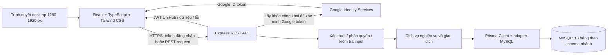

# Kiến trúc UniHub

Ngày ghi nhận thiết kế: **23/10/2026**; cập nhật Prisma runtime, API/router frontend, Hub cơ hội và auth schema **28/10/2026**. Đã có frontend kỹ thuật React, backend Express, schema, initial migration và adapter MySQL. Prisma Client dùng singleton lazy; `GET /api/health` chỉ kiểm tra HTTP còn `GET /api/ready` truy vấn MySQL. Migration/runtime được kiểm thử trên MySQL tạm ở Codex/Linux; không truy cập database thành viên. Xem [database-schema.md](database-schema.md), [database-migrations.md](database-migrations.md) và [database-runtime.md](database-runtime.md).

Danh sách nguồn đã đọc, đường dẫn PDF, phiên bản công nghệ và giới hạn truy cập Figma nằm trong [technology-stack.md](technology-stack.md); phiên bản Chương 3–4 vừa đối chiếu và hash nằm trong [api-contracts.md](api-contracts.md). **Chương 4 mô tả `users.google_sub` và `auth_sessions`; auth schema/migration/GRANT đã có trên `main`. Leader xác nhận database phát triển trên máy mình đã áp dụng migration; các database thành viên khác cần xác minh riêng.** PDF chưa ghi hai deadline metadata đã được duyệt. Đây là chênh lệch nguồn; tài liệu này nêu trạng thái nhánh, không thay thế việc cập nhật báo cáo Chương 4. Auth code hiện có trên `feat/auth-google-login`, chưa trên `main` cho tới khi PR được merge.

## 1. Thành phần và trách nhiệm



- **Frontend:** một ứng dụng React được build bằng Vite, có khu vực Public, Student, Admin. React Router declarative mode khai báo route tại `frontend/src/app/router.tsx`; `main` mount `/_dev/health`, `/_dev/ui`, `/404` và fallback `*`, còn `/` chuyển tới health. Frontend `main` có route `/opportunities` và `/opportunities/:id` cùng trang danh sách/chi tiết dùng chung sau PR #12. `/_dev/ui` preview ba shared layout và component; chưa có auth route guard. Sitemap Public/Student/Admin ở Chương 4 mục 4.1.1 được ghi dưới đây để phân công. Không tách Admin thành ứng dụng thứ hai.
- **Backend:** một REST API Express. Middleware kiểm tra phiên, quyền và dữ liệu đầu vào; service xử lý quy tắc, quyền sở hữu, chuyển trạng thái và transaction. Không tin `role`, `user_id`, `author_id` hoặc `admin_id` do frontend tự khai báo để cấp quyền.
- **Dữ liệu:** chỉ backend sử dụng Prisma và thông tin kết nối MySQL. Prisma không thay thế kiểm tra nghiệp vụ; MySQL chịu trách nhiệm ràng buộc cấu trúc và giao dịch.
- **Tác vụ nền:** nhắc hạn thuộc backend theo Chương 3, triển khai sau. Chưa chọn thư viện lập lịch, chưa thêm queue, Redis, dịch vụ cron ngoài hoặc tiến trình chạy thật.
- **Ranh giới API:** frontend dùng JSON qua REST và gọi qua client dùng chung `frontend/src/lib/api.ts`. Backend `main` có `GET /api/health` (liveness), `GET /api/ready` (readiness database), `GET /api/opportunities`, `GET /api/opportunities/:id`, 404 và error middleware. Chưa có API ghi/Admin hoặc API nghiệp vụ cho module khác. Xem [api-conventions.md](api-conventions.md).

### Router hiện có và sitemap được phân công

Các route sản phẩm bên dưới được chuyển từ sitemap Chương 4 mục 4.1.1. Trạng thái ghi rõ khi chỉ có trên nhánh chưa merge; quyền thực tế luôn cần kiểm tra ở backend. Route guard chưa được viết. Phân công theo yêu cầu mới nhất của nhóm:

| Route từ Chương 4 | Truy cập theo tài liệu | Phụ trách | Trạng thái trong frontend |
| --- | --- | --- | --- |
| `/` | Guest, Student | TV1 | Chưa có trang chủ; tạm chuyển tới `/_dev/health` |
| `/opportunities` | Guest, Student | TV1 | Danh sách có trên `main` sau PR #12; đọc API public có trên `main` |
| `/opportunities/:id` | Guest, Student | TV1 | Trang chi tiết dùng chung cho ba loại có trên `main` sau PR #12 |
| `/roadmaps` | Guest, Student | TV3 | Kế hoạch |
| `/roadmaps/:id` | Guest, Student | TV3 | Kế hoạch |
| `/login` | Guest | TV2 | Kế hoạch |
| `/profile` | Student | TV2 | Kế hoạch |
| `/recommendations` | Student | TV3 | Contract đã duyệt; route/page chưa triển khai |
| `/calendar` | Student | TV4 | Kế hoạch |
| `/forum` | Guest đọc, Student | TV5 | Kế hoạch |
| `/forum/:id` | Guest đọc, Student | TV5 | Kế hoạch |
| `/admin` → `/admin/dashboard` | Admin | TV4 | Kế hoạch |
| `/admin/dashboard` | Admin | TV4 | Kế hoạch |
| `/admin/moderation` | Admin | TV1: tab cơ hội; TV5: tab forum | Kế hoạch; cùng route, phân vùng tab |
| `/admin/categories` | Admin | TV3 | Kế hoạch |
| `/admin/users` | Admin | TV2 | Kế hoạch |
| `/terms` | Mọi người | Chưa phân công | Đường dẫn dự kiến đã chốt; trang nội dung tĩnh, chưa có nội dung hoặc route; không cần database/API riêng |
| `/privacy` | Mọi người | Chưa phân công | Đường dẫn dự kiến đã chốt; trang nội dung tĩnh, chưa có nội dung hoặc route; không cần database/API riêng |
| `/403` | Mọi người | Điều phối chung | Kế hoạch; chưa có xác thực/guard để dùng |
| `/404` | Mọi người | Điều phối chung | Màn hình tối giản; fallback `*` dùng cùng trang |
| `/_dev/health` | Kỹ thuật | TV1 | Đã mount; chỉ kiểm tra kết nối health |
| `/_dev/ui?area=public` (hoặc `student`, `admin`) | Kỹ thuật | TV1 | Đã mount; preview shared UI, không xác thực và không gọi API nghiệp vụ |

Không tạo menu giả để trỏ đến các route kế hoạch. `/admin/moderation` được TV1 và TV5 tích hợp trên một route chung theo hai tab; cả hai cần phối hợp trước khi đổi cấu trúc hoặc trạng thái tab.

Footer hiển thị label hỗ trợ dạng chữ tĩnh đến khi nhóm hoàn thiện nội dung `/terms` và `/privacy`; không tạo trang rỗng hoặc tự viết nội dung pháp lý.

## 2. Luồng xác thực và phân quyền

Luồng đã được nhóm chốt:

1. Frontend sử dụng Google Identity Services và nhận **Google ID token**.
2. Frontend gửi token tới endpoint đăng nhập backend qua HTTPS. Client ID là cấu hình công khai; không đưa Google client secret vào frontend.
3. Backend xác minh chữ ký bằng khóa công khai của Google, issuer, audience khớp client ID cấu hình, hạn token và các claim cần thiết. Chỉ giải mã JSON của JWT không đủ để xác thực. Không tin tên/email/role do client gửi kèm nếu chưa kiểm chứng.
4. Backend xử lý tra cứu tài khoản theo thiết kế đã thống nhất, lấy quyền từ dữ liệu UniHub và phát token **của UniHub**. Google ID token không được dùng thay JWT UniHub cho các API nghiệp vụ.
5. Mọi API được bảo vệ kiểm tra token UniHub, quyền và quyền sở hữu tài nguyên ở backend; frontend guard không phải biện pháp bảo vệ dữ liệu.

Chương 3 UC-04/NFR-02.4 quy định access tối đa 15 phút và refresh tối đa 7 ngày trong cookie bảo mật. BR-14.5 quy định role mới có hiệu lực ở lần cấp token kế tiếp. Contract tại [auth-api-contract.md](auth-api-contract.md) đã được leader duyệt; endpoint/cookie/security implementation chưa có. Chương 4 mô tả `google_sub`/`auth_sessions`; nhánh hiện tại thêm chúng bằng migration mới nhưng PR chưa merge hoặc áp dụng lên database đích. Vì vậy code auth chưa thể chạy trên database thật.

| Đối tượng | Ý nghĩa và nguồn quyền |
| --- | --- |
| Guest | Chưa đăng nhập; chỉ truy cập chức năng công khai. Không có giá trị `Guest` trong `users.role`. |
| Student | Tài khoản có `users.role = 'Student'`; backend kiểm tra chủ sở hữu khi thao tác hồ sơ, sự kiện, thông báo. |
| Admin | Tài khoản có `users.role = 'Admin'`; backend kiểm tra quyền cho mọi thao tác quản trị và ghi nhật ký theo use case. |

**Các điểm trước implementation:**

- Chương 3 hiện đã mô tả Google ID token; giữ flow đó, không đổi sang Authorization Code.
- Migration auth trên `main` bổ sung `google_sub` và `auth_sessions` bằng migration riêng; không sửa initial/deadline migration hoặc suy đoán `sub` từ email. Trước khi dùng auth code trên một database, xác nhận migration/GRANT đã áp dụng. Đây là điều kiện vận hành cho database đích.
- Không có yêu cầu khóa tài khoản/domain allowlist; không thêm `account_status` hoặc lock API.
- Giữ seed Admin theo UC-04/BR-04.2, không hardcode định danh cá nhân hoặc public bootstrap. Contract không tạo Admin/seed.

## 3. Cấu trúc scaffold và vị trí Prisma sau này

Theo yêu cầu ngày 24/10/2026, tổ chức frontend theo feature và backend theo module. Cây sau phản ánh phần scaffold chính; các thư mục nghiệp vụ mới có README phạm vi, không có endpoint hoặc component giả:

```text
UniHub/
├── frontend/                    # npm workspace: một ứng dụng React
│   ├── src/
│   │   ├── app/                 # router, health page và fallback 404
│   │   ├── features/            # README theo chức năng, gồm admin/
│   │   ├── components/ui/       # primitive Button/Input/Select/Badge/states
│   │   ├── layouts/             # PublicLayout/StudentLayout/AdminLayout
│   │   ├── assets/              # logo và icon Figma được shell sử dụng
│   │   ├── lib/                 # API client và kiểm tra health; không truy cập database
│   │   └── styles/              # Tailwind và design tokens shared UI
│   └── package.json
├── backend/                     # npm workspace: Express REST API
│   ├── src/
│   │   ├── config/              # đọc và kiểm tra cấu hình server
│   │   ├── middleware/          # 404 và xử lý lỗi; chưa có auth
│   │   ├── modules/             # health/readiness có mã; nghiệp vụ chỉ README
│   │   ├── lib/                 # singleton Prisma runtime
│   │   ├── app.ts               # cấu hình Express, không mở cổng
│   │   └── server.ts            # mở cổng, dừng server
│   ├── test/                    # kiểm thử bằng node:test
│   └── package.json
├── database/
│   └── README.md                # chỉ dẫn đến backend/prisma/ sau này
├── docs/
│   ├── technology-stack.md      # phiên bản và phạm vi
│   ├── architecture.md          # tài liệu kiến trúc; trạng thái schema nhánh 13 bảng
│   ├── team-workflow.md         # TV1–TV5, nhánh/commit/PR
│   ├── development-roadmap.md   # thứ tự công việc sau scaffold
│   ├── api-conventions.md       # health đã chạy, quy ước nghiệp vụ dự thảo
│   └── shared-ui-design/        # Figma Page 3 handoff, screenshot/evidence tham chiếu
├── package.json                 # private, workspaces: frontend + backend
├── package-lock.json            # một lockfile npm ở gốc
├── .gitignore
├── AGENTS.md                    # hướng dẫn Agent; .env.example ở mỗi workspace
└── README.md                    # tiếng Việt, lệnh chạy đúng trạng thái thực tế
```

Các module chưa có mã dùng README mô tả phạm vi. Hub cơ hội có backend read API, frontend list/detail và Major options provider/consumer trên `main` sau PR #11–#13; luồng Public được kiểm tra tích hợp trên MySQL thử nghiệm. Module này không bao gồm Admin duyệt. Admin chia theo chức năng: TV2 users, TV1 opportunities (tab trong moderation), TV3 categories, TV4 dashboard, TV5 forum (tab trong moderation). TV1 điều phối route/tích hợp và shared UI; layout/navbar/footer dùng shell từ Page 3. Xem [workflow](team-workflow.md), không tạo nhiều kiến trúc cạnh tranh hoặc một file Admin lớn.

**Vị trí dữ liệu duy nhất:** `backend/prisma/schema.prisma` là nguồn schema; `backend/prisma/migrations/` là lịch sử duy nhất, đã có initial migration sau PR #4. Prisma Client được sinh vào `backend/src/generated/prisma/` và không commit. `backend/src/lib/prisma.ts` tạo tối đa một client/pool cho tiến trình và chỉ đọc `DATABASE_URL`; migration dùng `MIGRATION_DATABASE_URL` riêng. Adapter MySQL thiết lập UTC ở từng physical connection; chi tiết phân biệt timezone session với DATETIME nằm trong [database-runtime.md](database-runtime.md). database/ không có bản schema/SQL thứ hai.

Các scripts tại root gồm `dev:frontend`, `dev:backend`, `typecheck`, `build`, `test`, `format`, `format:check`. Backend tự sinh Prisma Client trước dev/typecheck/build; không có migration ở các lifecycle này. Node nạp PORT và `DATABASE_URL` từ `.env` backend; thiếu DB vẫn phục vụ health, readiness trả 503. Frontend dùng Vite proxy `/api`; đây chỉ là cấu hình phát triển. Hướng dẫn ở [README](../README.md).

## 4. Nguyên tắc giữ nguyên mô hình dữ liệu

Chương 4 phiên bản trước mô tả **8 bảng thực thể + 4 bảng trung gian = 12 bảng** (§4.3.2.1–§4.3.2.12); PDF hiện hành thêm `users.google_sub` và `auth_sessions` ở §4.3.2.1/§4.3.2.13, thành 13 bảng. Phần dưới đối chiếu 12 bảng nghiệp vụ nền; bổ sung auth và trạng thái schema nhánh được ghi tại [database-schema.md](database-schema.md). Số cột và ràng buộc chạy thực tế cần xem [database-migrations.md](database-migrations.md).

- Giữ nguyên tên bảng/cột `snake_case`, tên khóa và kiểu MySQL, độ dài, nullable, mặc định, unique, khóa ghép, khóa ngoại. Model Prisma có thể dùng tên PascalCase với `@@map`; tên field giữ `snake_case` để dễ đối chiếu. Nếu sau này đổi tên field TypeScript sang camelCase, phải có `@map` để tên cột MySQL không đổi.
- Dùng provider `mysql` với khóa ngoại thật (`relationMode = "foreignKeys"`). Không chuyển sang quan hệ chỉ do Prisma mô phỏng.
- Bốn bảng trung gian phải là model tường minh; không dùng many-to-many ngầm định khiến Prisma sinh thêm bảng hoặc cột. `opportunity_years` chỉ liên kết cơ hội với giá trị năm 1–4, không tạo bảng năm học hoặc FK tới categories.
- Không tách `opportunities` thành bảng cơ hội và bảng lộ trình: Chương 4 lưu cả bài viết định hướng trong cùng bảng. Không tách `categories` thành bảng chuyên ngành và kỹ năng.
- Không đổi các cột `VARCHAR` + `CHECK` thành MySQL `ENUM`; dùng Prisma `String` với native type đúng và giữ `CHECK` trong SQL migration. Không mặc định đổi `TEXT` thành `LONGTEXT`, `DATETIME` thành `DATETIME(3)` hoặc `INT` thành `BIGINT`/unsigned.
- Prisma Migrate tạo bảng kỹ thuật `_prisma_migrations` khi migration áp dụng. Đây là lịch sử migration của công cụ, không phải bảng nghiệp vụ thứ 13.

### Quy ước đọc các bảng ánh xạ bên dưới

`?` là cho phép NULL và dùng Prisma scalar optional; trường còn lại là NOT NULL. `NULL` không thay bằng chuỗi rỗng. Cột tùy chọn không có giá trị mặc định khác được để NULL theo thiết kế. `AI` là `@default(autoincrement())`; `now` là `@default(now())` được render thành mặc định thời gian tại MySQL.

| MySQL trong Chương 4 | Biểu diễn Prisma phải giữ |
| --- | --- |
| `INT` | `Int @db.Int` |
| `TINYINT` | `Int @db.TinyInt` |
| `VARCHAR(n)` | `String @db.VarChar(n)` |
| `TEXT` | `String @db.Text` |
| `DATETIME` | `DateTime @db.DateTime(0)` — giữ độ chính xác của DATETIME không khai báo phần lẻ |
| `BOOLEAN` | `Boolean` — connector MySQL ánh xạ sang `TINYINT(1)` |
| PK đơn | `@id`; thêm `@default(autoincrement())` nếu có AI |
| PK ghép | `@@id([cột_1, cột_2])` theo đúng thứ tự thiết kế |
| UNIQUE | `@unique` hoặc `@@unique([...])` |
| FK | Scalar khóa ngoại và trường `@relation(fields: [...], references: [...])`; chiều ngược là relation field, không tạo thêm cột |

## 5. Đối chiếu Prisma với các bảng Chương 4

### 5.1. `users` → model `User`, `@@map("users")`

Nguồn: mục 4.3.2.1, trang 12–14. Bảng nền có **10 cột**; schema hiện tại của nhánh thêm `google_sub` thành 11.

| Cột | Kiểu MySQL → scalar Prisma | Khóa / mặc định |
| --- | --- | --- |
| `user_id` | INT → Int | PK, AI |
| `google_sub` | VARCHAR(255) → String? | UNIQUE; nullable legacy; cột dùng collation `utf8mb4_0900_as_cs` trong migration SQL |
| `email` | VARCHAR(255) → String | UNIQUE |
| `full_name` | VARCHAR(150) → String | — |
| `avatar_url` | VARCHAR(500) → String? | NULL |
| `role` | VARCHAR(10) → String | `'Student'` |
| `major_id` | INT → Int? | FK → categories.category_id; NULL |
| `academic_year` | TINYINT → Int? | NULL |
| `career_goal` | VARCHAR(200) → String? | NULL |
| `created_at` | DATETIME → DateTime | now |
| `updated_at` | DATETIME → DateTime | now; cập nhật khi bản ghi thay đổi |

Database: CHECK role thuộc `Student`, `Admin`; CHECK academic_year từ 1 đến 4 khi có giá trị. Backend: `major_id` phải trỏ danh mục type `Major`; hồ sơ đầy đủ gồm chuyên ngành, năm học và kỹ năng theo Chương 3. `career_goal` không tham gia điểm gợi ý. Chương 4 cho phép cập nhật `users.updated_at` ở DB hoặc ứng dụng; khi triển khai phải chọn rõ cơ chế, không nhầm `@updatedAt` là trigger database. Không có mật khẩu hoặc role `Guest` trong bảng.

### 5.2. `categories` → model `Category`, `@@map("categories")`

Nguồn: mục 4.3.2.2, trang 14–15. Có **5 cột**.

| Cột | Kiểu MySQL → scalar Prisma | Khóa / mặc định |
| --- | --- | --- |
| `category_id` | INT → Int | PK, AI |
| `type` | VARCHAR(10) → String | — |
| `name` | VARCHAR(100) → String | UNIQUE ghép `(type, name)` |
| `status` | VARCHAR(10) → String | `'Active'` |
| `created_at` | DATETIME → DateTime | now |

Database: `@@unique([type, name])`; CHECK type thuộc `Major`, `Skill`; CHECK status thuộc `Active`, `Closed`. Backend: không xóa cứng; mỗi loại luôn còn ít nhất một mục Active, kiểm tra trong transaction có kiểm soát cạnh tranh. FK không kiểm tra được quy tắc "còn ít nhất một Active".

### 5.3. `opportunities` → model `Opportunity`, `@@map("opportunities")`

Nguồn Chương 4: mục 4.3.2.3, trang 15–18, có **15 cột**. Nhóm đã duyệt hai metadata bổ sung ở nhánh hiện tại; §4.3.2.3 cần cập nhật trước khi nhóm coi tài liệu PDF đồng bộ.

| Cột | Kiểu MySQL → scalar Prisma | Khóa / mặc định |
| --- | --- | --- |
| `item_id` | INT → Int | PK, AI |
| `opportunity_type` | VARCHAR(30) → String | — |
| `title` | VARCHAR(255) → String | — |
| `description` | TEXT → String? | NULL |
| `requirements` | TEXT → String? | NULL |
| `publisher` | VARCHAR(255) → String? | NULL chỉ được chấp nhận theo CHECK bên dưới |
| `location` | VARCHAR(100) → String? | NULL |
| `work_format` | VARCHAR(10) → String? | NULL |
| `deadline` | DATETIME → DateTime? | NULL |
| `deadline_source_date` | DATE → DateTime? | NULL; migration đã duyệt, chưa có trong bản Chương 4 mới đính kèm |
| `deadline_source_timezone` | VARCHAR(64) → String? | NULL; migration đã duyệt, chưa có trong bản Chương 4 mới đính kèm |
| `status` | VARCHAR(10) → String | `'Pending'` |
| `is_verified` | BOOLEAN → Boolean | false |
| `source_url` | VARCHAR(500) → String? | NULL |
| `reviewed_by` | INT → Int? | FK → users.user_id; NULL |
| `reviewed_at` | DATETIME → DateTime? | NULL |
| `created_at` | DATETIME → DateTime | now |

Database: giữ ba CHECK của Chương 4 về work_format, status, publisher; migration metadata thêm CHECK cấu trúc `chk_opportunities_deadline_metadata` để ràng buộc metadata với deadline và cho phép legacy unknown. Không kiểm tra timezone/cutoff bằng SQL. Trường `opportunity_type` chỉ nhận `Thực tập`, `Việc làm`, `Học bổng`, `Bài viết định hướng` theo đặc tả; đây là miền giá trị cần backend xác thực, không tự đổi sang mã tiếng Anh hoặc ENUM.

Backend: xác minh timezone nguồn hợp lệ; với date-only, giữ ngày nguồn và tính cutoff 00:00 ngày kế tiếp `Asia/Ho_Chi_Minh`; với datetime, lưu đúng UTC instant cùng zone/offset nguồn. Dữ liệu cũ thiếu metadata giữ unknown, không suy ra từ timestamp. Location bắt buộc với Offline/Hybrid và NULL với Online; duyệt Approved phải kiểm chứng source_url hợp lệ; `reviewed_by` là Admin được xác thực. Thay đổi trạng thái, `is_verified`, người/thời điểm duyệt và nhật ký phải thống nhất trong giao dịch. Pending/Rejected có `is_verified = false`; không tự đánh dấu Verified cho bài định hướng chỉ vì nó Approved. Bài định hướng được thiết kế nạp sẵn Approved, reviewed_at NULL, không đi qua luồng kiểm duyệt; **chưa tạo dữ liệu này**. Nội dung description/requirements giữ quy ước mục `## Tên mục` và BR-01.8, không tự tách thành bảng mới.

### 5.4. `events` → model `Event`, `@@map("events")`

Nguồn: mục 4.3.2.4, trang 18–21. Có **10 cột**.

| Cột | Kiểu MySQL → scalar Prisma | Khóa / mặc định |
| --- | --- | --- |
| `event_id` | INT → Int | PK, AI |
| `user_id` | INT → Int | FK → users.user_id |
| `title` | VARCHAR(255) → String | — |
| `due_date` | DATETIME → DateTime | — |
| `remind_before` | INT → Int | 24 |
| `notes` | VARCHAR(1000) → String? | NULL |
| `status` | VARCHAR(10) → String | `'Upcoming'` |
| `reminded_at` | DATETIME → DateTime? | NULL |
| `created_at` | DATETIME → DateTime | now |
| `updated_at` | DATETIME → DateTime | now và tự cập nhật tại database |

Database: CHECK remind_before >=0; CHECK status thuộc `Upcoming`, `Completed`, `Overdue`. `updated_at` có `NOW() ON UPDATE NOW()` trong Chương 4: migration SQL phải giữ tương đương `DEFAULT CURRENT_TIMESTAMP ON UPDATE CURRENT_TIMESTAMP`. Chỉ gắn Prisma `@updatedAt` sẽ không bảo vệ các lệnh SQL cập nhật ngoài Prisma.

Backend: khi tạo mới hoặc đổi hạn, due_date phải lớn hơn hiện tại; khi chỉ sửa nội dung được giữ hạn cũ đã qua. Kiểm soát chuyển trạng thái, không tự mở lại Completed. Đổi due_date/remind_before phải reset reminded_at và xóa Reminder cũ trong cùng giao dịch. Tạo Reminder và cập nhật reminded_at phải nguyên tử, có kiểm soát việc hai tác vụ cùng nhắc một sự kiện; không tự thêm khóa unique trái thiết kế.

### 5.5. `forum_posts` → model `ForumPost`, `@@map("forum_posts")`

Nguồn: mục 4.3.2.5, trang 21–22. Có **9 cột**.

| Cột | Kiểu MySQL → scalar Prisma | Khóa / mặc định |
| --- | --- | --- |
| `post_id` | INT → Int | PK, AI |
| `author_id` | INT → Int | FK → users.user_id |
| `topic` | VARCHAR(30) → String | — |
| `title` | VARCHAR(255) → String | — |
| `content` | TEXT → String | — |
| `is_deleted` | BOOLEAN → Boolean | false |
| `deleted_at` | DATETIME → DateTime? | NULL |
| `deleted_reason` | VARCHAR(500) → String? | NULL |
| `created_at` | DATETIME → DateTime | now |

Backend: topic thuộc `Học tập`, `Thực tập`, `Kinh nghiệm phỏng vấn`; tác giả phải là Student được xác thực. Admin chỉ xóa mềm; lý do bắt buộc, không chỉ có khoảng trắng khi xóa. Nội dung bị xóa không được trả ra diễn đàn công khai. Xóa mềm, log và thông báo Violation phải cùng giao dịch; không suy diễn FK thành cơ chế kiểm duyệt.

### 5.6. `comments` → model `Comment`, `@@map("comments")`

Nguồn: mục 4.3.2.6, trang 22–23. Có **8 cột**.

| Cột | Kiểu MySQL → scalar Prisma | Khóa / mặc định |
| --- | --- | --- |
| `comment_id` | INT → Int | PK, AI |
| `post_id` | INT → Int | FK → forum_posts.post_id |
| `author_id` | INT → Int | FK → users.user_id |
| `content` | TEXT → String | — |
| `is_deleted` | BOOLEAN → Boolean | false |
| `deleted_at` | DATETIME → DateTime? | NULL |
| `deleted_reason` | VARCHAR(500) → String? | NULL |
| `created_at` | DATETIME → DateTime | now |

Backend: Student mới được bình luận; kiểm tra trạng thái bài đăng, quyền và nội dung. Xóa mềm/lý do/log/Violation theo quy tắc tương tự forum_posts. FK chỉ bảo đảm bài đăng và người dùng tồn tại, không kiểm tra role hoặc is_deleted.

### 5.7. `activity_logs` → model `ActivityLog`, `@@map("activity_logs")`

Nguồn: mục 4.3.2.7, trang 23–26. Có **9 cột**.

| Cột | Kiểu MySQL → scalar Prisma | Khóa / mặc định |
| --- | --- | --- |
| `log_id` | INT → Int | PK, AI |
| `admin_id` | INT → Int | FK → users.user_id |
| `action_type` | VARCHAR(30) → String | — |
| `target_type` | VARCHAR(20) → String | — |
| `target_id` | INT → Int | Tham chiếu logic, **không FK** |
| `old_value` | VARCHAR(500) → String? | NULL |
| `new_value` | VARCHAR(500) → String? | NULL |
| `reason` | VARCHAR(500) → String? | NULL |
| `created_at` | DATETIME → DateTime | now |

Database: CHECK action_type thuộc `APPROVE_OPPORTUNITY`, `REJECT_OPPORTUNITY`, `DELETE_POST`, `DELETE_COMMENT`, `CREATE_CATEGORY`, `RENAME_CATEGORY`, `CLOSE_CATEGORY`, `REOPEN_CATEGORY`, `CHANGE_ROLE`; CHECK target_type thuộc `Opportunity`, `ForumPost`, `Comment`, `Category`, `User`. Cấp quyền tài khoản ứng dụng chỉ INSERT/SELECT trên activity_logs theo Chương 4; tài khoản migration là trách nhiệm cấu hình riêng sau này. Prisma schema không biểu diễn GRANT này.

Backend: admin_id thực sự phải có quyền Admin; action_type/target_type/target_id phải khớp hành động. Reason bắt buộc cho từ chối cơ hội, xóa bài và xóa bình luận. Nhật ký append-only, ghi cùng transaction nghiệp vụ. Không có updated_at, không thêm quan hệ đa hình hoặc FK cho target_id; không dùng cascade xóa mất lịch sử.

### 5.8. `notifications` → model `Notification`, `@@map("notifications")`

Nguồn: mục 4.3.2.8, trang 26–28. Có **7 cột**.

| Cột | Kiểu MySQL → scalar Prisma | Khóa / mặc định |
| --- | --- | --- |
| `notification_id` | INT → Int | PK, AI |
| `user_id` | INT → Int | FK → users.user_id |
| `event_id` | INT → Int? | FK → events.event_id; NULL; **ON DELETE CASCADE** |
| `type` | VARCHAR(20) → String | — |
| `content` | VARCHAR(500) → String | — |
| `is_read` | BOOLEAN → Boolean | false |
| `created_at` | DATETIME → DateTime | now |

Database: CHECK type thuộc `Reminder`, `Violation`; relation event là optional và khai báo `onDelete: Cascade` đúng đặc tả. Backend: Reminder bắt buộc gắn sự kiện, Violation để event_id NULL; kiểm tra người nhận và chỉ chủ sở hữu được đánh dấu đã đọc. Reminder đi cùng cập nhật events.reminded_at; Violation đi cùng xóa mềm và log trong transaction.

### 5.9. `user_skills` → model `UserSkill`, `@@map("user_skills")`

Nguồn: mục 4.3.2.9, trang 28. Có **2 cột**.

| Cột | Kiểu MySQL → scalar Prisma | Khóa |
| --- | --- | --- |
| `user_id` | INT → Int | PK ghép; FK → users.user_id |
| `skill_id` | INT → Int | PK ghép; FK → categories.category_id |

Database: `@@id([user_id, skill_id])`, chống trùng cặp. Backend: skill_id phải có type `Skill`; áp dụng quy tắc trạng thái danh mục của use case. Không thêm id tự tăng hoặc timestamp.

### 5.10. `opportunity_majors` → model `OpportunityMajor`, `@@map("opportunity_majors")`

Nguồn: mục 4.3.2.10, trang 28–29. Có **2 cột**.

| Cột | Kiểu MySQL → scalar Prisma | Khóa |
| --- | --- | --- |
| `item_id` | INT → Int | PK ghép; FK → opportunities.item_id |
| `major_id` | INT → Int | PK ghép; FK → categories.category_id |

Database: `@@id([item_id, major_id])`. Backend: major_id phải có type `Major`. Không sinh thêm bảng liên kết ngầm định.

### 5.11. `opportunity_skills` → model `OpportunitySkill`, `@@map("opportunity_skills")`

Nguồn: mục 4.3.2.11, trang 29. Có **2 cột**.

| Cột | Kiểu MySQL → scalar Prisma | Khóa |
| --- | --- | --- |
| `item_id` | INT → Int | PK ghép; FK → opportunities.item_id |
| `skill_id` | INT → Int | PK ghép; FK → categories.category_id |

Database: `@@id([item_id, skill_id])`. Backend: skill_id phải có type `Skill`. Bảng này đối chiếu với user_skills để gợi ý, không lưu điểm gợi ý mới ngoài thiết kế.

### 5.12. `opportunity_years` → model `OpportunityYear`, `@@map("opportunity_years")`

Nguồn: mục 4.3.2.12, trang 29–30. Có **2 cột**.

| Cột | Kiểu MySQL → scalar Prisma | Khóa |
| --- | --- | --- |
| `item_id` | INT → Int | PK ghép; FK → opportunities.item_id |
| `academic_year` | TINYINT → Int | PK ghép; CHECK 1–4 |

Database: `@@id([item_id, academic_year])`, CHECK academic_year BETWEEN 1 AND 4. Không FK từ academic_year tới categories hoặc bảng khác.

### 5.13. `auth_sessions` → model `AuthSession`, `@@map("auth_sessions")`

Nguồn: Chương 4 §4.3.2.13. Bảng session có sáu cột theo [bảng schema chi tiết](database-schema.md#bổ-sung-auth-identity-session-theo-chương-4). FK tới `users.user_id` dùng RESTRICT/RESTRICT; `session_id` là UUID, `refresh_token_hash` được lưu thay cho secret thô, timestamp UTC dùng `DATETIME(0)`. Nhánh auth hiện thêm model/migration; middleware, login, refresh và logout chưa có.

## 6. Ranh giới database và backend

| Nhóm ràng buộc | Nơi bảo đảm chính | Cách đưa vào triển khai sau này |
| --- | --- | --- |
| PK, FK, NOT NULL, kiểu/độ dài, UNIQUE email, UNIQUE `(type, name)`, bốn PK ghép | MySQL | Prisma scalar/native type, `@id`, `@unique`, `@@id`, `@@unique`, `@relation`; review SQL thực sinh |
| Các CHECK được ghi trong Chương 4 | MySQL, backend kiểm tra sớm để báo lỗi rõ | SQL trong migration được review; không bỏ CHECK hoặc thay VARCHAR bằng ENUM |
| `notifications.event_id ON DELETE CASCADE` | MySQL | Relation Prisma optional với `onDelete: Cascade` |
| Cập nhật tự động `events.updated_at` | MySQL | SQL `ON UPDATE CURRENT_TIMESTAMP`; không chỉ dùng `@updatedAt` |
| Major phải trỏ danh mục Major, Skill phải trỏ Skill; người thao tác đúng role | Backend | Đọc dữ liệu liên quan và kiểm tra trong service; FK chỉ kiểm tra bản ghi tồn tại |
| Quyền sở hữu hồ sơ/sự kiện/thông báo; Guest chỉ đọc công khai | Backend | Lấy danh tính từ phiên đã xác thực, kiểm tra từng yêu cầu và tài nguyên |
| Còn ít nhất một danh mục Active mỗi loại; quy tắc quản trị tài khoản trong Chương 3 | Backend + transaction MySQL | Thiết kế khóa/cô lập hoặc kiểm soát cạnh tranh; kiểm tra rồi cập nhật rời rạc chưa đủ |
| Chuyển trạng thái, duyệt nguồn, location, due_date, lý do xóa/từ chối | Backend | Validation theo ngữ cảnh use case; không coi constraint scalar là đủ |
| Log chỉ thêm | Backend và quyền MySQL | Service không sửa/xóa log; tài khoản runtime chỉ INSERT/SELECT trên bảng log |
| Nghiệp vụ + log + notification; nhắc hạn + reminded_at | Backend điều phối, MySQL commit/rollback | Prisma transaction và kiểm soát đồng thời, bảo đảm thành công/thất bại cùng nhau |

**Quyết định bổ sung đã xác nhận ngày 24/10/2026:** ngoài ON DELETE CASCADE của `notifications.event_id` có sẵn trong Chương 4, nhóm chọn ON DELETE RESTRICT cho 15 FK khác và ON UPDATE RESTRICT cho cả 16 FK. Schema khai báo tường minh, không dùng default ORM. Nhóm cũng chọn MySQL tự cập nhật cả `users.updated_at` và `events.updated_at`; initial migration đã ghi ON UPDATE CURRENT_TIMESTAMP, không thay bằng `@updatedAt`. Đây là quyết định bổ sung của nhóm, không được trình bày như nội dung vốn có của Chương 4.

SQL `CHECK` theo thiết kế cũng không bảo đảm mọi điều kiện nghiệp vụ: ví dụ `publisher IS NOT NULL` không loại chuỗi toàn khoảng trắng; FK `reviewed_by` không bảo đảm role Admin. Backend vẫn phải kiểm tra. Không thêm trigger, index nghiệp vụ hoặc constraint chưa được thống nhất chỉ để làm mô hình trông hoàn chỉnh hơn.

## 7. Kiểm tra trước khi chuyển sang mã nguồn

Kiểm đếm tĩnh: Prisma `origin/main` baseline có 12 model/83 cột, 12 PK, 16 FK và hai UNIQUE ngoài PK. Nhánh auth có 13 model/90 cột, 13 PK, 17 FK và bốn UNIQUE ngoài PK. PDF Chương 4 hiện hành mô tả 13 bảng, có `google_sub`/`auth_sessions`, nhưng chưa ghi hai deadline metadata. `activity_logs.target_id` không phải FK. Đây là nội dung cần đồng bộ trong báo cáo; PDF chưa được sửa. Kiểm thử DDL thực tế và giới hạn ở [database-migrations.md](database-migrations.md).

Sau scaffold, các bước tiếp theo và phạm vi kiểm tra:

1. Đối chiếu môi trường môn học với Node/MySQL đã chọn; giữ phiên bản và một lockfile npm ở gốc.
2. Hai workspace tối thiểu, Tailwind 3/PostCSS và build target trình duyệt đã được cấu hình; duy trì kiểm tra typecheck/build, HTTP test và khởi động khi sửa. Chưa đưa chức năng nghiệp vụ vào scaffold.
3. Initial migration đã có trên `main` qua PR #4; schema, CHECK, FK, collation, timestamp và GRANT đã được kiểm tra trên MySQL tạm theo [database-migrations.md](database-migrations.md). Runtime adapter/readiness và quyền tài khoản ứng dụng được kiểm tra riêng tại [database-runtime.md](database-runtime.md).
4. Đối chiếu Node/MySQL với môi trường môn học và kiểm tra kết nối trên từng máy Windows. Mọi thay đổi dữ liệu tiếp theo phải dùng migration mới, được review trước khi áp dụng vào database phát triển riêng.
5. Trước khi làm auth, xử lý các điểm Google identity/session ở mục 2; trước khi làm UI nghiệp vụ, dùng frame đúng mục đích trong [handoff Figma Page 3](shared-ui-design/README.md) và không coi spacing suy ra là token gốc.

Hiện có health/readiness HTTP, schema, Prisma runtime, hai API đọc công khai cho cơ hội, frontend list/detail và API provider Major trên `main` sau PR #11–#13. Luồng Public được kiểm tra trên MySQL tạm và Chromium; chi tiết ở [báo cáo tích hợp](opportunities-integration-test.md). Xem [trạng thái schema](database-schema.md#5-trạng-thái-kiểm-tra-và-giới-hạn) và [kiểm tra runtime](database-runtime.md). Chưa có API ghi/Admin, xác thực, dữ liệu nghiệp vụ thật hoặc hosting. Runtime chưa được đối chiếu với MySQL máy Windows của thành viên; pool cấu hình nhỏ chưa phải bằng chứng NFR hiệu năng hoặc 100 người dùng đồng thời.
