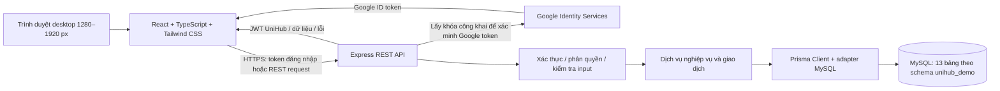

# Kiến trúc UniHub

> **Đối chiếu bản bàn giao đồ án:** Hệ thống UniHub đã hoàn thiện đầy đủ toàn bộ các phân hệ nghiệp vụ, giao diện người dùng, dịch vụ backend và cơ sở dữ liệu MySQL 13 bảng theo thiết kế. Cài đặt môi trường cục bộ tuân thủ theo [README](../README.md) và [LOCAL-SETUP-UNIHUB-DEMO.md](LOCAL-SETUP-UNIHUB-DEMO.md) với schema `unihub_demo`.

Hệ thống kiến trúc được đóng gói và vận hành theo mô hình 4 tầng phân tách rõ ràng: Giao diện người dùng (React 19 SPA), Cổng định tuyến & Bảo vệ (Reverse Proxy / Routing Guards), Dịch vụ nghiệp vụ (Express 5 REST API), và Tầng dữ liệu (Prisma ORM & MySQL 8.4 LTS). Mọi quy tắc phân quyền, kiểm tra tính hợp lệ dữ liệu và tính toán gợi ý đều được kiểm soát chặt chẽ tại Backend.

## 1. Thành phần và trách nhiệm



- **Frontend:** Một ứng dụng React 19 SPA được đóng gói bằng Vite, phân định rõ ràng các khu vực Public, Student và Admin. Bộ định tuyến React Router Declarative tại [`frontend/src/app/router.tsx`](../frontend/src/app/router.tsx) bảo vệ các route nhạy cảm thông qua component `<RequireRole>`, chuyển hướng người dùng chưa đăng nhập về `/login` và sinh viên không có quyền truy cập Admin về `/403`.
- **Backend:** Một REST API Express 5 độc lập. Middleware kiểm tra phiên CSDL thực tế trong bảng `auth_sessions`, dùng role snapshot trong JWT cho tới lần cấp token tiếp theo theo BR-14.5, và kiểm soát quyền sở hữu tài nguyên cho từng sinh viên. Các thao tác nhạy cảm (như duyệt bài, hạ quyền Admin, thay đổi vai trò) đều được bọc trong Prisma Transaction với cơ chế khóa dòng (`SELECT ... FOR UPDATE`) nhằm hạn chế rủi ro tương tranh và bảo vệ Admin cuối cùng.
- **Dữ liệu:** Chỉ backend kết nối MySQL thông qua Prisma Client singleton tại `backend/src/lib/prisma.ts`. Cơ sở dữ liệu duy trì mô hình 13 bảng chuẩn hóa, bảo đảm toàn vẹn tham chiếu thông qua Foreign Keys cấp cơ sở dữ liệu.
- **Tác vụ nền (Background Worker):** Module Scheduler nhắc hạn sự kiện (`reminders.scheduler.ts`) chạy định kỳ tự động, quét các sự kiện lịch cá nhân sắp đến hạn trong vòng 24 giờ và sinh thông báo nhắc nhở (`Reminder`) một cách an toàn và chống trùng lặp.
- **Ranh giới API:** Frontend giao tiếp với Backend thông qua chuẩn JSON RESTful API với bộ định dạng phản hồi và xử lý lỗi đồng nhất được đặc tả tại [api-conventions.md](api-conventions.md).

### Router hiện có và sitemap được phân công

Các route sản phẩm bên dưới được chuyển từ sitemap Chương 4 mục 4.1.1. Trạng thái ghi rõ khi chỉ có trên nhánh chưa merge; quyền thực tế luôn cần kiểm tra ở backend. Route guard chưa được viết. Phân công theo yêu cầu mới nhất của nhóm:

| Route từ Chương 4 | Truy cập theo tài liệu | Phụ trách | Trạng thái trong frontend |
| --- | --- | --- | --- |
| `/` | Guest, Student | TV1 | Đã hoàn thành; Trang chủ HomePage |
| `/opportunities` | Guest, Student | TV1 | Đã hoàn thành; Hub cơ hội (OpportunityHubPage) |
| `/opportunities/:id` | Guest, Student | TV1 | Đã hoàn thành; Chi tiết cơ hội (OpportunityDetailPage) |
| `/roadmaps` | Guest, Student | TV3 | Đã hoàn thành; Danh sách lộ trình kỹ năng (GuidanceRoadmapPage) |
| `/roadmaps/:id` | Guest, Student | TV3 | Đã hoàn thành; Chi tiết bài viết định hướng (GuidanceDetailPage) |
| `/login` | Guest | TV2 | Đã hoàn thành; Trang đăng nhập Google (LoginPage) |
| `/profile` | Student | TV2 | Đã hoàn thành; Hồ sơ học tập chuyên ngành và kỹ năng (ProfilePage) |
| `/recommendations` | Student | TV3 | Đã hoàn thành; Gợi ý cơ hội cá nhân hóa Heuristic (RecommendationsPage) |
| `/calendar` | Student | TV4 | Đã hoàn thành; Lịch sự kiện & Deadline cá nhân (CalendarPage) |
| `/forum` | Guest đọc, Student | TV5 | Đã hoàn thành; Diễn đàn sinh viên (ForumHubPage) |
| `/forum/:id` | Guest đọc, Student | TV5 | Đã hoàn thành; Chi tiết bài viết & bình luận (ForumPostDetailPage) |
| `/admin` → `/admin/dashboard` | Admin | TV4 | Đã hoàn thành; Tự động chuyển hướng sang /admin/dashboard |
| `/admin/dashboard` | Admin | TV4 | Đã hoàn thành; Admin Dashboard thống kê thời gian thực |
| `/admin/moderation` | Admin | TV1: tab cơ hội; TV5: tab forum | Đã hoàn thành; Thẩm định cơ hội (Tab 1) & Kiểm duyệt diễn đàn (Tab 2) |
| `/admin/categories` | Admin | TV3 | Đã hoàn thành; Quản trị danh mục ngành học & kỹ năng |
| `/admin/users` | Admin | TV2 | Đã hoàn thành; Quản trị tài khoản & phân quyền RBAC |
| `/terms` | Mọi người | Chưa phân công | Nhãn văn bản tĩnh hỗ trợ chân trang |
| `/privacy` | Mọi người | Chưa phân công | Nhãn văn bản tĩnh hỗ trợ chân trang |
| `/403` | Mọi người | Điều phối chung | Đã hoàn thành; Trang từ chối truy cập (ForbiddenPage) |
| `/404` | Mọi người | Điều phối chung | Đã hoàn thành; Trang không tìm thấy tài nguyên (NotFoundPage) |
| `/_dev/health` | Kỹ thuật | TV1 | Đã mount; kiểm tra kết nối health |
| `/_dev/ui?area=public` (hoặc `student`, `admin`) | Kỹ thuật | TV1 | Đã mount; preview shared UI, không gọi API nghiệp vụ |

Không tạo menu giả để trỏ đến các route kế hoạch. `/admin/moderation` được TV1 và TV5 tích hợp trên một route chung theo hai tab; cả hai phối hợp đồng bộ cấu trúc và trạng thái tab.

Footer hiển thị label hỗ trợ dạng chữ tĩnh đến khi nhóm hoàn thiện nội dung `/terms` và `/privacy`; không tạo trang rỗng hoặc tự viết nội dung pháp lý.

## 2. Luồng xác thực và phân quyền

Luồng đã được nhóm triển khai đầy đủ và kiểm nghiệm:

1. Frontend sử dụng Google Identity Services và nhận **Google ID token**.
2. Frontend gửi token tới endpoint đăng nhập backend qua HTTPS. Client ID là cấu hình công khai; không đưa Google client secret vào frontend.
3. Backend xác minh chữ ký bằng khóa công khai của Google, issuer, audience khớp client ID cấu hình, hạn token và các claim cần thiết. Chỉ giải mã JSON của JWT không đủ để xác thực. Không tin tên/email/role do client gửi kèm nếu chưa kiểm chứng.
4. Backend xử lý tra cứu tài khoản theo thiết kế đã thống nhất, lấy quyền từ dữ liệu UniHub và phát token **của UniHub**. Google ID token không được dùng thay JWT UniHub cho các API nghiệp vụ.
5. Mọi API được bảo vệ kiểm tra token UniHub, quyền và quyền sở hữu tài nguyên ở backend; frontend guard không phải biện pháp bảo vệ dữ liệu duy nhất.

Chương 3 UC-04/NFR-02.4 quy định access tối đa 15 phút và refresh tối đa 7 ngày trong cookie bảo mật (`HttpOnly; Secure; SameSite=Strict`). Middleware kiểm tra `auth_sessions`; logout thu hồi phiên. Thay đổi vai trò không thu hồi phiên và có hiệu lực ở lần cấp access token tiếp theo theo BR-14.5. Cơ chế bảo vệ Quản trị viên cuối cùng có trong service; test cạnh tranh dùng fixture JavaScript chưa chứng minh khóa trên MySQL. Contract tại [auth-api-contract.md](auth-api-contract.md).

| Đối tượng | Ý nghĩa và nguồn quyền |
| --- | --- |
| Guest | Chưa đăng nhập; chỉ truy cập chức năng công khai. Không có giá trị `Guest` trong `users.role`. |
| Student | Tài khoản có `users.role = 'Student'`; backend kiểm tra chủ sở hữu khi thao tác hồ sơ, sự kiện, thông báo. |
| Admin | Tài khoản có `users.role = 'Admin'`; backend kiểm tra quyền cho mọi thao tác quản trị và ghi nhật ký theo use case. |

**Các điểm trước implementation:**

- Chương 3 hiện đã mô tả Google ID token; giữ flow đó, không đổi sang Authorization Code.
- Migration auth trên `main` bổ sung `google_sub` và `auth_sessions` bằng migration riêng; không sửa initial/deadline migration hoặc suy đoán `sub` từ email. Trước khi dùng auth code trên một database, xác nhận migration/GRANT đã áp dụng. Đây là điều kiện vận hành cho database đích.
- Không có yêu cầu khóa tài khoản/domain allowlist; không thêm `account_status` hoặc lock API.
- Giữ seed Admin theo UC-04/BR-04.2, không hardcode định danh cá nhân hoặc public bootstrap. Contract không tạo Admin/seed.

## 3. Cấu trúc thư mục mã nguồn

Cấu trúc dự án được phân chia theo kiến trúc Modular Monorepo: Frontend tổ chức theo tính năng (`features/`), Backend tổ chức theo các phân hệ nghiệp vụ (`modules/`):

```text
UniHub/
├── frontend/                    # npm workspace: Ứng dụng React 19 SPA
│   ├── src/
│   │   ├── app/                 # Router, các trang điều hướng và fallback lỗi
│   │   ├── features/            # Phân hệ nghiệp vụ (auth, opportunities, profile, guidance, recommendations, calendar, notifications, forum, admin)
│   │   ├── components/ui/       # Thư viện component giao diện dùng chung (Button, Input, Select, Badge, states...)
│   │   ├── layouts/             # Các khung giao diện chính (PublicLayout, StudentLayout, AdminLayout)
│   │   ├── assets/              # Tài nguyên hình ảnh, logo và font chữ Inter Variable
│   │   ├── lib/                 # HTTP client, token management và utilities
│   │   └── styles/              # Tailwind CSS và design tokens hệ thống
│   └── package.json
├── backend/                     # npm workspace: Dịch vụ Express 5 REST API
│   ├── src/
│   │   ├── config/              # Quản lý nạp và kiểm tra biến môi trường
│   │   ├── middleware/          # Xác thực JWT, kiểm tra quyền RBAC, xử lý lỗi tập trung
│   │   ├── modules/             # Các module nghiệp vụ (auth, opportunities, guidance, recommendations, events, notifications, forum, categories, users, dashboard, activity-logs)
│   │   ├── lib/                 # Singleton Prisma Client runtime
│   │   ├── app.ts               # Khởi tạo Express, cấu hình middleware và routes
│   │   └── server.ts            # Quản lý vòng đời tiến trình, mở cổng và graceful shutdown
│   ├── test/                    # Bộ kiểm thử tự động Node.js test runner
│   ├── prisma/                  # Schema CSDL 13 bảng và lịch sử migrations
│   └── package.json
├── data/                        # Dữ liệu seed mẫu chuẩn hóa cho demo
├── docs/                        # Hệ thống tài liệu kỹ thuật chuẩn hóa của dự án
├── package.json                 # Cấu hình workspace npm ở thư mục gốc
├── package-lock.json            # Tệp khóa phiên bản dependency duy nhất
├── AGENTS.md                    # Hướng dẫn quy chuẩn cho Agent lập trình
└── README.md                    # Tài liệu hướng dẫn cài đặt và bàn giao chính thức
```

Các phân hệ Admin được phân chia theo trách nhiệm chức năng TV1–TV5 trong [team-workflow.md](team-workflow.md): TV1 duyệt cơ hội, TV2 quản lý tài khoản & phân quyền, TV3 quản lý danh mục ngành & kỹ năng, TV4 bảng điều khiển thống kê (Dashboard), TV5 kiểm duyệt diễn đàn cộng đồng.

**Vị trí dữ liệu duy nhất:** `backend/prisma/schema.prisma` là nguồn định nghĩa schema CSDL duy nhất; `backend/prisma/migrations/` lưu trữ toàn bộ lịch sử migrations chính thức. Prisma Client được sinh cục bộ vào `backend/src/generated/prisma/` và không commit vào Git. `backend/src/lib/prisma.ts` tạo một Prisma Client singleton dùng chung cho toàn bộ tiến trình ứng dụng. Mọi thao tác DDL của migrator sử dụng biến `MIGRATION_DATABASE_URL`, còn runtime backend kết nối thông qua tài khoản đặc quyền tối thiểu `DATABASE_URL`.

Các scripts tại root gồm `dev:frontend`, `dev:backend`, `typecheck`, `build`, `test`, `format`, `format:check`. Backend tự sinh Prisma Client trước dev/typecheck/build; không có migration ở các lifecycle này. Node nạp PORT và `DATABASE_URL` từ `.env` backend; thiếu DB vẫn phục vụ health, readiness trả 503. Frontend dùng Vite proxy `/api`; đây chỉ là cấu hình phát triển. Hướng dẫn ở [README](../README.md).

## 4. Nguyên tắc giữ nguyên mô hình dữ liệu

Chương 4 phiên bản trước mô tả **8 bảng thực thể + 4 bảng trung gian = 12 bảng** (§4.3.2.1–§4.3.2.12); PDF hiện hành thêm `users.google_sub` và `auth_sessions` ở §4.3.2.1/§4.3.2.13, thành 13 bảng. Phần dưới đối chiếu 12 bảng nghiệp vụ nền; bổ sung auth và trạng thái schema nhánh được ghi tại [database-schema.md](database-schema.md). Số cột và ràng buộc chạy thực tế cần xem [database-migrations.md](database-migrations.md).

- Giữ nguyên tên bảng/cột `snake_case`, tên khóa và kiểu MySQL, độ dài, nullable, mặc định, unique, khóa ghép, khóa ngoại. Model Prisma có thể dùng tên PascalCase với `@@map`; tên field giữ `snake_case` để dễ đối chiếu. Nếu sau này đổi tên field TypeScript sang camelCase, phải có `@map` để tên cột MySQL không đổi.
- Dùng provider `mysql` với khóa ngoại thật (`relationMode = "foreignKeys"`). Không chuyển sang quan hệ chỉ do Prisma mô phỏng.
- Bốn bảng trung gian phải là model tường minh; không dùng many-to-many ngầm định khiến Prisma sinh thêm bảng hoặc cột. `opportunity_years` chỉ liên kết cơ hội với giá trị năm 1–4, không tạo bảng năm học hoặc FK tới categories.
- Không tách `opportunities` thành bảng cơ hội và bảng lộ trình: Chương 4 lưu cả bài viết định hướng trong cùng bảng. Không tách `categories` thành bảng chuyên ngành và kỹ năng.
- Không đổi các cột `VARCHAR` + `CHECK` thành MySQL `ENUM`; dùng Prisma `String` với native type đúng và giữ `CHECK` trong SQL migration. Không mặc định đổi `TEXT` thành `LONGTEXT`, `DATETIME` thành `DATETIME(3)` hoặc `INT` thành `BIGINT`/unsigned.
- Prisma Migrate tạo bảng kỹ thuật `_prisma_migrations` khi migration áp dụng. Đây là lịch sử migration của công cụ, không phải bảng nghiệp vụ thứ 13.

### Quy ước đọc các bảng ánh xạ bên dưới

`?` là cho phép NULL và dùng Prisma scalar optional; trường còn lại là NOT NULL. `NULL` không thay bằng chuỗi rỗng. Cột tùy chọn không có giá trị mặc định khác được để NULL theo thiết kế. `AI` là `@default(autoincrement())`; `now` là `@default(now())` được render thành mặc định thời gian tại MySQL.

| MySQL trong Chương 4 | Biểu diễn Prisma phải giữ |
| --- | --- |
| `INT` | `Int @db.Int` |
| `TINYINT` | `Int @db.TinyInt` |
| `VARCHAR(n)` | `String @db.VarChar(n)` |
| `TEXT` | `String @db.Text` |
| `DATETIME` | `DateTime @db.DateTime(0)` — giữ độ chính xác của DATETIME không khai báo phần lẻ |
| `BOOLEAN` | `Boolean` — connector MySQL ánh xạ sang `TINYINT(1)` |
| PK đơn | `@id`; thêm `@default(autoincrement())` nếu có AI |
| PK ghép | `@@id([cột_1, cột_2])` theo đúng thứ tự thiết kế |
| UNIQUE | `@unique` hoặc `@@unique([...])` |
| FK | Scalar khóa ngoại và trường `@relation(fields: [...], references: [...])`; chiều ngược là relation field, không tạo thêm cột |

## 5. Đối chiếu Prisma với các bảng Chương 4

### 5.1. `users` → model `User`, `@@map("users")`

Nguồn: mục 4.3.2.1, trang 12–14. Bảng nền có **10 cột**; schema hiện tại của nhánh thêm `google_sub` thành 11.

| Cột | Kiểu MySQL → scalar Prisma | Khóa / mặc định |
| --- | --- | --- |
| `user_id` | INT → Int | PK, AI |
| `google_sub` | VARCHAR(255) → String? | UNIQUE; nullable legacy; cột dùng collation `utf8mb4_0900_as_cs` trong migration SQL |
| `email` | VARCHAR(255) → String | UNIQUE |
| `full_name` | VARCHAR(150) → String | — |
| `avatar_url` | VARCHAR(500) → String? | NULL |
| `role` | VARCHAR(10) → String | `'Student'` |
| `major_id` | INT → Int? | FK → categories.category_id; NULL |
| `academic_year` | TINYINT → Int? | NULL |
| `career_goal` | VARCHAR(200) → String? | NULL |
| `created_at` | DATETIME → DateTime | now |
| `updated_at` | DATETIME → DateTime | now; cập nhật khi bản ghi thay đổi |

Database: CHECK role thuộc `Student`, `Admin`; CHECK academic_year từ 1 đến 4 khi có giá trị. Backend: `major_id` phải trỏ danh mục type `Major`; hồ sơ đầy đủ gồm chuyên ngành, năm học và kỹ năng theo Chương 3. `career_goal` không tham gia điểm gợi ý. Chương 4 cho phép cập nhật `users.updated_at` ở DB hoặc ứng dụng; khi triển khai phải chọn rõ cơ chế, không nhầm `@updatedAt` là trigger database. Không có mật khẩu hoặc role `Guest` trong bảng.

### 5.2. `categories` → model `Category`, `@@map("categories")`

Nguồn: mục 4.3.2.2, trang 14–15. Có **5 cột**.

| Cột | Kiểu MySQL → scalar Prisma | Khóa / mặc định |
| --- | --- | --- |
| `category_id` | INT → Int | PK, AI |
| `type` | VARCHAR(10) → String | — |
| `name` | VARCHAR(100) → String | UNIQUE ghép `(type, name)` |
| `status` | VARCHAR(10) → String | `'Active'` |
| `created_at` | DATETIME → DateTime | now |

Database: `@@unique([type, name])`; CHECK type thuộc `Major`, `Skill`; CHECK status thuộc `Active`, `Closed`. Backend: không xóa cứng; mỗi loại luôn còn ít nhất một mục Active, kiểm tra trong transaction có kiểm soát cạnh tranh. FK không kiểm tra được quy tắc "còn ít nhất một Active".

### 5.3. `opportunities` → model `Opportunity`, `@@map("opportunities")`

Nguồn Chương 4: mục 4.3.2.3, trang 15–18, có **15 cột**. Nhóm đã duyệt hai metadata bổ sung ở nhánh hiện tại; §4.3.2.3 cần cập nhật trước khi nhóm coi tài liệu PDF đồng bộ.

| Cột | Kiểu MySQL → scalar Prisma | Khóa / mặc định |
| --- | --- | --- |
| `item_id` | INT → Int | PK, AI |
| `opportunity_type` | VARCHAR(30) → String | — |
| `title` | VARCHAR(255) → String | — |
| `description` | TEXT → String? | NULL |
| `requirements` | TEXT → String? | NULL |
| `publisher` | VARCHAR(255) → String? | NULL chỉ được chấp nhận theo CHECK bên dưới |
| `location` | VARCHAR(100) → String? | NULL |
| `work_format` | VARCHAR(10) → String? | NULL |
| `deadline` | DATETIME → DateTime? | NULL |
| `deadline_source_date` | DATE → DateTime? | NULL; migration đã duyệt, chưa có trong bản Chương 4 mới đính kèm |
| `deadline_source_timezone` | VARCHAR(64) → String? | NULL; migration đã duyệt, chưa có trong bản Chương 4 mới đính kèm |
| `status` | VARCHAR(10) → String | `'Pending'` |
| `is_verified` | BOOLEAN → Boolean | false |
| `source_url` | VARCHAR(500) → String? | NULL |
| `reviewed_by` | INT → Int? | FK → users.user_id; NULL |
| `reviewed_at` | DATETIME → DateTime? | NULL |
| `created_at` | DATETIME → DateTime | now |

Database: giữ ba CHECK của Chương 4 về work_format, status, publisher; migration metadata thêm CHECK cấu trúc `chk_opportunities_deadline_metadata` để ràng buộc metadata với deadline và cho phép legacy unknown. Không kiểm tra timezone/cutoff bằng SQL. Trường `opportunity_type` chỉ nhận `Thực tập`, `Việc làm`, `Học bổng`, `Bài viết định hướng` theo đặc tả; đây là miền giá trị cần backend xác thực, không tự đổi sang mã tiếng Anh hoặc ENUM.

Backend: xác minh timezone nguồn hợp lệ; với date-only, giữ ngày nguồn và tính cutoff 00:00 ngày kế tiếp `Asia/Ho_Chi_Minh`; với datetime, lưu đúng UTC instant cùng zone/offset nguồn. Dữ liệu cũ thiếu metadata giữ unknown, không suy ra từ timestamp. Location bắt buộc với Offline/Hybrid và NULL với Online; duyệt Approved phải kiểm chứng source_url hợp lệ; `reviewed_by` là Admin được xác thực. Thay đổi trạng thái, `is_verified`, người/thời điểm duyệt và nhật ký phải thống nhất trong giao dịch. Pending/Rejected có `is_verified = false`; không tự đánh dấu Verified cho bài định hướng chỉ vì nó Approved. Bài định hướng được thiết kế nạp sẵn Approved, reviewed_at NULL, không đi qua luồng kiểm duyệt; **chưa tạo dữ liệu này**. Nội dung description/requirements giữ quy ước mục `## Tên mục` và BR-01.8, không tự tách thành bảng mới.

### 5.4. `events` → model `Event`, `@@map("events")`

Nguồn: mục 4.3.2.4, trang 18–21. Có **10 cột**.

| Cột | Kiểu MySQL → scalar Prisma | Khóa / mặc định |
| --- | --- | --- |
| `event_id` | INT → Int | PK, AI |
| `user_id` | INT → Int | FK → users.user_id |
| `title` | VARCHAR(255) → String | — |
| `due_date` | DATETIME → DateTime | — |
| `remind_before` | INT → Int | 24 |
| `notes` | VARCHAR(1000) → String? | NULL |
| `status` | VARCHAR(10) → String | `'Upcoming'` |
| `reminded_at` | DATETIME → DateTime? | NULL |
| `created_at` | DATETIME → DateTime | now |
| `updated_at` | DATETIME → DateTime | now và tự cập nhật tại database |

Database: CHECK remind_before >=0; CHECK status thuộc `Upcoming`, `Completed`, `Overdue`. `updated_at` có `NOW() ON UPDATE NOW()` trong Chương 4: migration SQL phải giữ tương đương `DEFAULT CURRENT_TIMESTAMP ON UPDATE CURRENT_TIMESTAMP`. Chỉ gắn Prisma `@updatedAt` sẽ không bảo vệ các lệnh SQL cập nhật ngoài Prisma.

Backend: khi tạo mới hoặc đổi hạn, due_date phải lớn hơn hiện tại; khi chỉ sửa nội dung được giữ hạn cũ đã qua. Kiểm soát chuyển trạng thái, không tự mở lại Completed. Đổi due_date/remind_before phải reset reminded_at và xóa Reminder cũ trong cùng giao dịch. Tạo Reminder và cập nhật reminded_at phải nguyên tử, có kiểm soát việc hai tác vụ cùng nhắc một sự kiện; không tự thêm khóa unique trái thiết kế.

### 5.5. `forum_posts` → model `ForumPost`, `@@map("forum_posts")`

Nguồn: mục 4.3.2.5, trang 21–22. Có **9 cột**.

| Cột | Kiểu MySQL → scalar Prisma | Khóa / mặc định |
| --- | --- | --- |
| `post_id` | INT → Int | PK, AI |
| `author_id` | INT → Int | FK → users.user_id |
| `topic` | VARCHAR(30) → String | — |
| `title` | VARCHAR(255) → String | — |
| `content` | TEXT → String | — |
| `is_deleted` | BOOLEAN → Boolean | false |
| `deleted_at` | DATETIME → DateTime? | NULL |
| `deleted_reason` | VARCHAR(500) → String? | NULL |
| `created_at` | DATETIME → DateTime | now |

Backend: topic thuộc `Học tập`, `Thực tập`, `Kinh nghiệm phỏng vấn`; tác giả phải là Student được xác thực. Admin chỉ xóa mềm; lý do bắt buộc, không chỉ có khoảng trắng khi xóa. Nội dung bị xóa không được trả ra diễn đàn công khai. Xóa mềm, log và thông báo Violation phải cùng giao dịch; không suy diễn FK thành cơ chế kiểm duyệt.

### 5.6. `comments` → model `Comment`, `@@map("comments")`

Nguồn: mục 4.3.2.6, trang 22–23. Có **8 cột**.

| Cột | Kiểu MySQL → scalar Prisma | Khóa / mặc định |
| --- | --- | --- |
| `comment_id` | INT → Int | PK, AI |
| `post_id` | INT → Int | FK → forum_posts.post_id |
| `author_id` | INT → Int | FK → users.user_id |
| `content` | TEXT → String | — |
| `is_deleted` | BOOLEAN → Boolean | false |
| `deleted_at` | DATETIME → DateTime? | NULL |
| `deleted_reason` | VARCHAR(500) → String? | NULL |
| `created_at` | DATETIME → DateTime | now |

Backend: Student mới được bình luận; kiểm tra trạng thái bài đăng, quyền và nội dung. Xóa mềm/lý do/log/Violation theo quy tắc tương tự forum_posts. FK chỉ bảo đảm bài đăng và người dùng tồn tại, không kiểm tra role hoặc is_deleted.

### 5.7. `activity_logs` → model `ActivityLog`, `@@map("activity_logs")`

Nguồn: mục 4.3.2.7, trang 23–26. Có **9 cột**.

| Cột | Kiểu MySQL → scalar Prisma | Khóa / mặc định |
| --- | --- | --- |
| `log_id` | INT → Int | PK, AI |
| `admin_id` | INT → Int | FK → users.user_id |
| `action_type` | VARCHAR(30) → String | — |
| `target_type` | VARCHAR(20) → String | — |
| `target_id` | INT → Int | Tham chiếu logic, **không FK** |
| `old_value` | VARCHAR(500) → String? | NULL |
| `new_value` | VARCHAR(500) → String? | NULL |
| `reason` | VARCHAR(500) → String? | NULL |
| `created_at` | DATETIME → DateTime | now |

Database: CHECK action_type thuộc `APPROVE_OPPORTUNITY`, `REJECT_OPPORTUNITY`, `DELETE_POST`, `DELETE_COMMENT`, `CREATE_CATEGORY`, `RENAME_CATEGORY`, `CLOSE_CATEGORY`, `REOPEN_CATEGORY`, `CHANGE_ROLE`; CHECK target_type thuộc `Opportunity`, `ForumPost`, `Comment`, `Category`, `User`. Cấp quyền tài khoản ứng dụng chỉ INSERT/SELECT trên activity_logs theo Chương 4; tài khoản migration là trách nhiệm cấu hình riêng sau này. Prisma schema không biểu diễn GRANT này.

Backend: admin_id thực sự phải có quyền Admin; action_type/target_type/target_id phải khớp hành động. Reason bắt buộc cho từ chối cơ hội, xóa bài và xóa bình luận. Nhật ký append-only, ghi cùng transaction nghiệp vụ. Không có updated_at, không thêm quan hệ đa hình hoặc FK cho target_id; không dùng cascade xóa mất lịch sử.

### 5.8. `notifications` → model `Notification`, `@@map("notifications")`

Nguồn: mục 4.3.2.8, trang 26–28. Có **7 cột**.

| Cột | Kiểu MySQL → scalar Prisma | Khóa / mặc định |
| --- | --- | --- |
| `notification_id` | INT → Int | PK, AI |
| `user_id` | INT → Int | FK → users.user_id |
| `event_id` | INT → Int? | FK → events.event_id; NULL; **ON DELETE CASCADE** |
| `type` | VARCHAR(20) → String | — |
| `content` | VARCHAR(500) → String | — |
| `is_read` | BOOLEAN → Boolean | false |
| `created_at` | DATETIME → DateTime | now |

Database: CHECK type thuộc `Reminder`, `Violation`; relation event là optional và khai báo `onDelete: Cascade` đúng đặc tả. Backend: Reminder bắt buộc gắn sự kiện, Violation để event_id NULL; kiểm tra người nhận và chỉ chủ sở hữu được đánh dấu đã đọc. Reminder đi cùng cập nhật events.reminded_at; Violation đi cùng xóa mềm và log trong transaction.

### 5.9. `user_skills` → model `UserSkill`, `@@map("user_skills")`

Nguồn: mục 4.3.2.9, trang 28. Có **2 cột**.

| Cột | Kiểu MySQL → scalar Prisma | Khóa |
| --- | --- | --- |
| `user_id` | INT → Int | PK ghép; FK → users.user_id |
| `skill_id` | INT → Int | PK ghép; FK → categories.category_id |

Database: `@@id([user_id, skill_id])`, chống trùng cặp. Backend: skill_id phải có type `Skill`; áp dụng quy tắc trạng thái danh mục của use case. Không thêm id tự tăng hoặc timestamp.

### 5.10. `opportunity_majors` → model `OpportunityMajor`, `@@map("opportunity_majors")`

Nguồn: mục 4.3.2.10, trang 28–29. Có **2 cột**.

| Cột | Kiểu MySQL → scalar Prisma | Khóa |
| --- | --- | --- |
| `item_id` | INT → Int | PK ghép; FK → opportunities.item_id |
| `major_id` | INT → Int | PK ghép; FK → categories.category_id |

Database: `@@id([item_id, major_id])`. Backend: major_id phải có type `Major`. Không sinh thêm bảng liên kết ngầm định.

### 5.11. `opportunity_skills` → model `OpportunitySkill`, `@@map("opportunity_skills")`

Nguồn: mục 4.3.2.11, trang 29. Có **2 cột**.

| Cột | Kiểu MySQL → scalar Prisma | Khóa |
| --- | --- | --- |
| `item_id` | INT → Int | PK ghép; FK → opportunities.item_id |
| `skill_id` | INT → Int | PK ghép; FK → categories.category_id |

Database: `@@id([item_id, skill_id])`. Backend: skill_id phải có type `Skill`. Bảng này đối chiếu với user_skills để gợi ý, không lưu điểm gợi ý mới ngoài thiết kế.

### 5.12. `opportunity_years` → model `OpportunityYear`, `@@map("opportunity_years")`

Nguồn: mục 4.3.2.12, trang 29–30. Có **2 cột**.

| Cột | Kiểu MySQL → scalar Prisma | Khóa |
| --- | --- | --- |
| `item_id` | INT → Int | PK ghép; FK → opportunities.item_id |
| `academic_year` | TINYINT → Int | PK ghép; CHECK 1–4 |

Database: `@@id([item_id, academic_year])`, CHECK academic_year BETWEEN 1 AND 4. Không FK từ academic_year tới categories hoặc bảng khác.

### 5.13. `auth_sessions` → model `AuthSession`, `@@map("auth_sessions")`

Nguồn: Chương 4 §4.3.2.13. Bảng session có sáu cột theo [bảng schema chi tiết](database-schema.md#bổ-sung-auth-identity-session-theo-chương-4). FK tới `users.user_id` dùng RESTRICT/RESTRICT; `session_id` là UUID, `refresh_token_hash` được lưu thay cho secret thô, timestamp UTC dùng `DATETIME(0)`. Bảng `auth_sessions` cùng toàn bộ luồng xác thực Google SSO, quản lý phiên, cấp phát JWT và kiểm soát phân quyền RBAC đã được hoàn thiện và tích hợp đầy đủ trong mã nguồn.

## 6. Ranh giới database và backend

| Nhóm ràng buộc | Nơi bảo đảm chính | Cách đưa vào triển khai |
| --- | --- | --- |
| PK, FK, NOT NULL, kiểu/độ dài, UNIQUE email, UNIQUE `(type, name)`, bốn PK ghép | MySQL | Prisma scalar/native type, `@id`, `@unique`, `@@id`, `@@unique`, `@relation`; review SQL thực sinh |
| Các CHECK được ghi trong Chương 4 | MySQL, backend kiểm tra sớm để báo lỗi rõ | SQL trong migration được review; không bỏ CHECK hoặc thay VARCHAR bằng ENUM |
| `notifications.event_id ON DELETE CASCADE` | MySQL | Relation Prisma optional với `onDelete: Cascade` |
| Cập nhật tự động `events.updated_at` | MySQL | SQL `ON UPDATE CURRENT_TIMESTAMP`; không chỉ dùng `@updatedAt` |
| Major phải trỏ danh mục Major, Skill phải trỏ Skill; người thao tác đúng role | Backend | Đọc dữ liệu liên quan và kiểm tra trong service; FK chỉ kiểm tra bản ghi tồn tại |
| Quyền sở hữu hồ sơ/sự kiện/thông báo; Guest chỉ đọc công khai | Backend | Lấy danh tính từ phiên đã xác thực, kiểm tra từng yêu cầu và tài nguyên |
| Còn ít nhất một danh mục Active mỗi loại; quy tắc quản trị tài khoản trong Chương 3 | Backend + transaction MySQL | Thiết kế khóa/cô lập hoặc kiểm soát cạnh tranh; kiểm tra rồi cập nhật rời rạc chưa đủ |
| Chuyển trạng thái, duyệt nguồn, location, due_date, lý do xóa/từ chối | Backend | Validation theo ngữ cảnh use case; không coi constraint scalar là đủ |
| Log chỉ thêm | Backend và quyền MySQL | Service không sửa/xóa log; tài khoản runtime chỉ INSERT/SELECT trên bảng log |
| Nghiệp vụ + log + notification; nhắc hạn + reminded_at | Backend điều phối, MySQL commit/rollback | Prisma transaction và kiểm soát đồng thời, bảo đảm thành công/thất bại cùng nhau |

SQL `CHECK` theo thiết kế cũng không bảo đảm mọi điều kiện nghiệp vụ: ví dụ `publisher IS NOT NULL` không loại chuỗi toàn khoảng trắng; FK `reviewed_by` không bảo đảm role Admin. Backend vẫn phải kiểm tra. Không thêm trigger, index nghiệp vụ hoặc constraint chưa được thống nhất.

## 7. Trạng thái thẩm định và nghiệm thu hệ thống

Hệ thống đã trải qua quá trình thẩm định kỹ thuật và kiểm thử chức năng toàn diện trước khi bàn giao:

1. **Kiểm tra cú pháp CSDL:** `npm run prisma:validate` xác nhận tính toàn vẹn 13 bảng quan hệ.
2. **Kiểm tra kiểu dữ liệu tĩnh:** `npm run typecheck` đạt 0 lỗi TypeScript trên cả frontend và backend.
3. **Đóng gói mã nguồn:** `npm run build` hoàn thành build production cho cả 2 workspace mà không có lỗi.
4. **Bộ kiểm thử tự động:** Lượt Windows 10/11/2026 sau sửa BR-14.5: `npm test` chạy 560 test (478 PASS / 0 FAIL / 82 SKIP do thiếu runner Playwright hoặc cấu hình MySQL test cô lập). Kiểm chứng MySQL chạy riêng bằng `node backend/test/run-submission-mysql.mjs --run-isolated`: 55 kiểm tra quyền SQL và 1 test Auth MySQL PASS; không chứng minh khóa cạnh tranh khi hạ quyền Admin.
5. **Bộ kiểm thử nghiệm thu chức năng đồ án:** Đạt chuẩn 28/28 PASS đối chiếu theo tài liệu nghiệm thu chính thức của đề tài (5 Guest, 12 Student, 10 Admin - trong đó TC-18 là Dashboard quản trị, 1 Ngoại lệ & Bảo mật).
